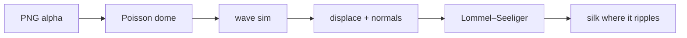

English | [简体中文](README.zh-CN.md)

# silkify

**[Open the live gallery →](https://russguo.github.io/silkify/examples/)**

**Silkify anything.** silkify turns any image into a touchable silk surface on the web. At rest the object is matte and photographic. Where your pointer touches it, the surface dents, ripples and catches the light like satin.

silkify is a small WebGL library (one ES module on top of [three.js](https://threejs.org)) and an [Agent Skill](SKILL.md) that teaches any coding agent how to cut out a picture, inflate it and embed it in any page.

## Use it from your agent

silkify is an [Agent Skill](https://agentskills.io): one [SKILL.md](SKILL.md) that any coding agent can follow, from cutting out the picture to the finished page. Nothing has to be copied into your project, because the skill imports silk.js from the CDN.

| Agent | Install |
|---|---|
| Claude Code | `/plugin marketplace add RussGuo/silkify`, then `/plugin install silkify@silkify` |
| Codex (CLI, IDE extension) and the ChatGPT desktop app | `git clone --depth 1 https://github.com/RussGuo/silkify ~/.agents/skills/silkify` |
| Cursor | the same clone (Cursor reads `~/.agents/skills`), or copy [`integrations/cursor/silkify.mdc`](integrations/cursor/silkify.mdc) into `.cursor/rules/` |
| GitHub Copilot | the same clone (Copilot reads `~/.agents/skills`), or, for one repository, copy [`integrations/copilot/silkify.instructions.md`](integrations/copilot/silkify.instructions.md) into `.github/instructions/` (it applies to page and component files only) |
| Gemini CLI | the same clone (`~/.agents/skills` is an alias of `~/.gemini/skills`) |
| OpenCode, Amp and other skill-aware agents | the same clone, or `npx skills add RussGuo/silkify` |
| Anything else | paste [SKILL.md](SKILL.md) into the chat, or point the agent at [llms.txt](llms.txt) |

Then ask it to "silkify" a picture. Add `--branch v0.2.0` to the clone to pin a release. The files for Cursor and Copilot, [AGENTS.md](AGENTS.md) and [llms.txt](llms.txt) are generated from SKILL.md by `npm run build:integrations`, so every host reads the same instructions.

## Gallery

Every frame below is a real headless-Chrome render of [`examples/index.html`](examples/index.html), recorded by [`scripts/shoot.mjs`](scripts/shoot.mjs). The left column shows the object untouched. The right column is a 2.8-second loop: a pointer stroke, a short press, then the ripples dying away. Try it yourself in the [live gallery](https://russguo.github.io/silkify/examples/).

| | at rest | touched (2.8 s loop) |
|---|---|---|
| **A drop of ink**: the FateTell mark, tinted ink with grain |  |  |
| **The Moon**: NASA LRO maps on a sphere, waxing gibbous |  |  |
| **Pomegranate**: USDA watercolour, 1920 |  |  |
| **Young Hare**: Albrecht Dürer, 1502 |  |  |
| **Teapot**: tôle and wicker, England, c. 1800 |  |  |
| **Mona Lisa**: as a silk cushion |  |  |
| **Portrait of a Man**: Rosalba Carriera, c. 1710 |  |  |
| **Enamel parrot**: gold and enamel, 18th century |  |  |

The images are public domain or CC0; see [examples/CREDITS.md](examples/CREDITS.md). The left column is the gallery's poster: a still frame rendered by silkify itself. The GIFs are recorded in the high tier on the main thread, using SwiftShader, a software GPU. They are frame-stepped (three simulation steps per GIF frame at 20 fps), so the motion has the same timing as 60 fps on a real GPU. The GIF palette and the 320 px width soften the grain and the highlights.

**[Open the Lab →](https://russguo.github.io/silkify/examples/lab.html)** Every option on one page: drag a slider and the object changes live, pick a `material` and a `feel`, press Touch or Stroke to see the feel without a mouse, hold B to compare with the defaults, drop in your own picture, then copy the options or share the link (the whole state is in the URL). One picture per preset is in [docs/shots/lab](docs/shots/lab).


To run the gallery yourself, serve the repository root and open `/examples/`:

```bash
npx serve .            # or: python3 -m http.server
```

## 30-second start

```html
<canvas id="pear" style="width: 420px; aspect-ratio: 1"></canvas>
<canvas id="moon" style="width: 420px; aspect-ratio: 1"></canvas>

<script type="importmap">
  { "imports": { "three": "https://cdn.jsdelivr.net/npm/three@0.152.2/build/three.module.js" } }
</script>
<script type="module">
  import { silkify } from 'https://cdn.jsdelivr.net/gh/RussGuo/silkify@v0.2.0/src/silk.js';   // or copy src/ and import './src/silk.js'

  silkify(document.getElementById('pear'), { image: 'pear.png' });            // any PNG with a transparent background
  silkify(document.getElementById('moon'), { image: 'moon.png', shape: 'sphere' });   // an equirectangular map
</script>
```

- **No transparent background?** Run `python3 scripts/cutout.py photo.jpg out.png` to key out a plain backdrop, or keep the rectangle and let silkify make a cushion.
- **React?** See the component in [SKILL.md](SKILL.md#react-and-nextjs).
- **From an agent?** See [Use it from your agent](#use-it-from-your-agent).

`silkify()` returns a handle right away:

```js
const silk = silkify(canvas, options);
await silk.ready;                         // 'webgl' when live, 'static' when drawn once, 'failed' (see silk.reason)
silk.setTheme({ exposure: 0.9, floor: 0.4 });
silk.dispose();
```

## Parameters at a glance

Two words cover most looks: `material` (`'silk'`, `'satin'`, `'velvet'`, `'wet'`, `'foil'`, `'paper'`, `'ink'`) sets what the surface is made of, and `feel` (`'silk'`, `'water'`, `'gel'`, `'jelly'`) sets how it answers a touch, as in `silkify(canvas, { image, material: 'foil', feel: 'water' })`. Explicit options always win over both. To find your own values, use the [Lab](https://russguo.github.io/silkify/examples/lab.html).

| Group | Options (defaults) |
|---|---|
| Presets | `material` (`'silk'`) · `feel` (`'silk'`) |
| Ripple | `pressDepth` 0.30 · `pressDepthHold` 0.60 · `pressRadius` 0.075 · `waveSpeed` 1.6 · `damping` 0.996 · `displace` 0.32 · `ripple` 62 |
| Material | `sheen` 0.18 sphere / 0.3 image · `sheenPower` 22 / 16 · `sheenColor` `[0.9,0.95,1]` · `satin` 0.9 · `albedo` null or `[r,g,b]` · `grain` 0 · `grainScale` 1 · `gamma` 1 · `exposure` 1 · `metallic` 0 · `anisotropy` 0 · `anisotropyAngle` 0 · `threads` 0 · `rim` 0 · `rimPower` 3 · `rimColor` `[1,1,1]` or null · `iridescence` 0 · `silkRest` 0 · `silkSpread` 1 |
| Light | `light` (view-space key light) · `lightColor` `[1,1,1]` · `satinLight` `[0.5,0.6,0.45]` · `floor` 0.05 / 0.55 · `volume` 0.28 · `fillLight` true · `idleSweep` true |
| Motion | `autoplay` false or `{ interval, depth, radius }` · `breeze` 0 · `handle.ripple(x, y)` |
| Shape (image) | `puff` `'dome'` / `'cushion'` / `'flat'` / a number · `matte` `'auto'` / `'alpha'` / `'rect'` · `corner` 0.06 · `threshold` 0.5 · `fit` 1.3 |
| Shape (sphere) | `phase` null or 0–1 · `bump` (elevation map) · `bumpStrength` 7 · `spin` true · `spinSpeed` 0.006 · `angle` 0 |
| Runtime | `interactive` true · `tier` `'auto'` / `'high'` / `'low'` / `'static'` · `worker` `'auto'` / false · `threeUrl` · `poster` · `dpr` (per tier) · `reducedMotion` `'auto'` · `onHover` |

[references/parameters.md](references/parameters.md) explains what each option does and how to tune it and gives recipes for logos, photos, paintings and the moon; [references/troubleshooting.md](references/troubleshooting.md) has the fixes.

## How it works



1. **Silhouette → dome.** The alpha channel gives the outline (an opaque picture becomes a rounded rectangle). silkify solves Poisson's equation ∇²u = −1 inside the outline with u = 0 on it, and sets the height to 2√u. For a disc this is exactly a hemisphere. Thin parts bulge less, and there is no crease along the middle like the one a distance field folds in. The moon skips this step and uses a real sphere.
2. **Waves.** A damped wave equation runs on two half-float render targets in ping-pong: r holds height and g holds velocity. The pointer presses a dent into it. For images, the field is zeroed outside the silhouette, so waves reflect off the outline and the outline never moves.
3. **Displacement and normals.** The height field moves the surface: along the normal for the sphere, and along the view axis for images, so the outline cannot fold. The ripple slope is added to the normal. For images it is scaled by n.z, which is the exact sum for a height field and fades to zero at the outline.
4. **Matte photometry.** The surface is lit by Lommel–Seeliger, the back-scattering model of lunar soil. The lit face stays almost flat, so the picture looks like itself, and the terminator is crisp. A floor keeps the far side from going black. A fill-light gradient follows the pointer on a critically damped spring and drifts slowly when idle.
5. **Silk only where touched.** A satin overlay and a soft highlight both scale with the local ripple energy. At rest that energy is zero, so the object is a photograph. Where it ripples, the object turns to silk, and nothing switches abruptly between the two materials.

## Performance

By default, silkify renders inside a **Web Worker** on an OffscreenCanvas, so three.js, picture decoding, the Poisson solve, shader compilation and every frame stay off the main thread. Where workers cannot render, it falls back to the main thread; without WebGL2 it falls back to a still frame.

| Tier | When | What it does |
|---|---|---|
| `high` | desktop-class devices | pixel ratio ≤ 2, simulation ≤ 256 cells, mesh ≤ 240; one idle light loop, then sleep |
| `low` | touch-first, a screen < 1024 px on its long side, ≤ 4 cores, ≤ 4 GB, or a software GPU | pixel ratio 1, simulation ≤ 128, mesh ≤ 120; frames only around interaction |
| `static` | reduced motion, Save-Data, 2G, very small devices, no WebGL2 | three.js is never loaded; `poster` (or the picture) is drawn once |

The tier is decided once, at mount; `tier` forces one.
- **Resolution** (simulation, mesh, texture) follows the object's size on screen, with sub-stepping that keeps dents and waves the same size and speed.
- **No MSAA, no depth or stencil buffer.** They add nothing to this picture and cost about 18 MB per canvas at ratio 2.
- **The loop sleeps:**
  - 60 fps while touched and for 8 s after;
  - 12 fps for the ripple tail until 20 s;
  - then nothing.
  - A lifted finger stops counting as hovering, and a pointer anywhere else on the page never wakes the object.
  - The wave solver runs at a fixed 60 steps a second, so ripples move at the same speed on a 30, 60 or 120 Hz display.
  - `breeze` and `autoplay` are off by default because they keep it awake: breeze draws 30 fps while visible, and autoplay wakes for every drop.
  - Off-screen and hidden tabs stop the loop.
  - The pixel ratio steps down 2 → 1.5 → 1 if the GPU falls behind.

The gallery shows the pattern for many objects on a page:
- Each card starts as a lazy-loaded WebP **poster** (a real rendered rest frame, 1x/2x).
- The live renderer mounts on the first touch and is released when the card scrolls away.
- At most 3 are live at once.

Measured on the gallery: Lighthouse 12.8.2, mobile preset (4× CPU slowdown), median of 3 runs, headless Chrome.

| | Before (8 live canvases on the main thread) | After |
|---|---|---|
| Performance score | 73 | **100** |
| Total Blocking Time | 964 ms | **18 ms** |
| Main-thread work | 5.14 s | **0.25 s** |
| Bytes transferred | 8.0 MB | **0.49 MB** |
| Cumulative Layout Shift | 0.086 | **0** |
| Main-thread long task when an object mounts | — | 94 ms on the main thread; **none** in the worker |
| Frames drawn in 10 s of idle (35–45 s after a touch) | 264 (never sleeps) | **0** |
| GPU buffers, estimated (373 px card, ratio 2) | ≈ 29 MB × 8 ≈ 230 MB | ≈ 5 MB × at most 3, and 0 until touched |

Lighthouse never touches the page, so the last three rows were measured separately with headless Chrome over the DevTools protocol. Details are in [references/performance.md](references/performance.md).

## Repository

```
SKILL.md            the Agent Skill: get the code (CDN or copy), cut-out → puff → material and feel → render → verify
references/         parameters, performance, troubleshooting: the detail SKILL.md points to
src/silk.js         the entry point: tiers, Worker / main-thread / still-frame fallback, pointer forwarding
src/core.js         the renderer, DOM-free (peer dependency: three ≥ 0.152.2)
src/shaders.js      the GLSL: wave solver and object shader (one source, two shapes)
src/worker.js       the Web Worker entry
src/presets.js      material and feel presets: plain option fragments
src/tier.js         device tiers and on-screen grid sizing
src/shape.js        silhouette → Poisson dome, plain arrays (no three.js)
scripts/cutout.py   Pillow + numpy background keying, shadow-aware, edge un-mixing
scripts/shoot.mjs   headless Chrome: verify (live in a worker + ripples, then the Lab), --posters, --gif (ffmpeg), --lab, --cdn; console check
scripts/build-integrations.mjs   SKILL.md + references → integrations/, AGENTS.md, llms.txt (--check for drift)
scripts/frameworks.mjs           the React component in Vite and Next.js, dev and build (Playwright; network)
scripts/harness.mjs              the static server and the Playwright loader the check scripts share
examples/           the gallery, the Lab and cdn.html (static; GitHub Pages), WebP pictures and posters, image credits
examples/react, examples/next    the smallest Vite and Next.js projects with the React component
test/edge.html      the cases that once failed silently: SVG, an empty or missing picture, calls while loading
integrations/       generated: a Cursor rule and a path-scoped Copilot instruction
AGENTS.md, llms.txt generated: for agents that read AGENTS.md, and the llmstxt.org index
.claude-plugin/     the plugin marketplace manifest (the skill is SKILL.md at the root)
```

## Credits

The silk material and the wave-and-light pipeline began as the "silk moon" on the author's personal site. This repository generalises it to any silhouette by adding Poisson inflation, an orthographic camera, displacement along the view axis and waves zeroed outside the outline. Moon data: NASA's Scientific Visualization Studio, CGI Moon Kit. Gallery images: see [examples/CREDITS.md](examples/CREDITS.md).

## License

The code is under the [MIT](LICENSE) license, © 2026 Guo Hao. The example images keep their own terms: public domain or CC0, except the FateTell mark (see [CREDITS](examples/CREDITS.md)).

