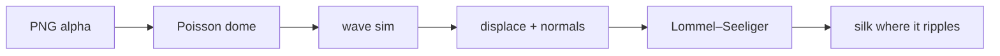

English | [简体中文](README.zh-CN.md)

# silkify

**[Open the live gallery →](https://russguo.github.io/silkify/examples/)**

**Silkify anything.** silkify turns any image into a touchable silk surface on the web. At rest the object is matte and photographic. Where your pointer touches it, the surface dents, ripples and catches the light like satin.

silkify is a small WebGL library (one ES module on top of [three.js](https://threejs.org)) and an [Agent Skill](SKILL.md) that teaches Claude how to cut out a picture, inflate it and embed it in any page.

## Gallery

Every frame below is a real headless-Chrome render of [`examples/index.html`](examples/index.html), recorded by [`scripts/shoot.mjs`](scripts/shoot.mjs). The left column shows the object untouched. The right column is a 2.8-second loop: a pointer stroke, a short press, then the ripples dying away. Try it yourself in the [live gallery](https://russguo.github.io/silkify/examples/).

| | at rest | touched (2.8 s loop) |
|---|---|---|
| **A drop of ink**: the FateTell mark, tinted ink with grain |  |  |
| **The Moon**: NASA LRO maps on a sphere, waxing gibbous |  |  |
| **Pomegranate**: USDA watercolour, 1920 |  |  |
| **Young Hare**: Albrecht Dürer, 1502 |  |  |
| **Teapot**: tôle and wicker, England, c. 1800 |  |  |
| **Mona Lisa**: as a silk cushion |  |  |
| **Portrait of a Man**: Rosalba Carriera, c. 1710 |  |  |
| **Enamel parrot**: gold and enamel, 18th century |  |  |

The images are public domain or CC0; see [examples/CREDITS.md](examples/CREDITS.md). The recordings use SwiftShader, a software GPU, and are frame-stepped (three simulation steps per GIF frame at 20 fps), so the motion has the same timing as 60 fps on a real GPU. The GIF palette and the 320 px width soften the grain and the highlights.

To run the gallery yourself, serve the repository root and open `/examples/`:

```bash
npx serve .            # or: python3 -m http.server
```

## 30-second start

```html
<canvas id="pear" style="width: 420px; aspect-ratio: 1"></canvas>

<script type="importmap">
  { "imports": { "three": "https://cdn.jsdelivr.net/npm/three@0.152.2/build/three.module.js" } }
</script>
<script type="module">
  import { silkify } from './src/silk.js';   // copy src/silk.js and src/shape.js

  silkify(document.getElementById('pear'), { image: 'pear.png' });            // any PNG with a transparent background
  silkify(document.getElementById('moon'), { image: 'moon.png', shape: 'sphere' });   // an equirectangular map
</script>
```

- **No transparent background?** Run `python3 scripts/cutout.py photo.jpg out.png` to key out a plain backdrop, or keep the rectangle and let silkify make a cushion.
- **React?** See the component in [SKILL.md](SKILL.md#react-and-nextjs).
- **Use it as a Claude skill:** `git clone https://github.com/RussGuo/silkify ~/.claude/skills/silkify`, then ask Claude to "silkify" an image.

`silkify()` returns a handle right away:

```js
const silk = silkify(canvas, options);
await silk.ready;                         // mounted ('webgl'), or drawn once ('static') when WebGL2 is missing
silk.setTheme({ exposure: 0.9, floor: 0.4 });
silk.dispose();
```

## Parameters at a glance

| Group | Options (defaults) |
|---|---|
| Ripple | `pressDepth` 0.30 · `pressDepthHold` 0.60 · `pressRadius` 0.075 · `waveSpeed` 1.6 · `damping` 0.996 · `displace` 0.32 · `ripple` 62 |
| Material | `sheen` 0.18 sphere / 0.3 image · `sheenPower` 22 / 16 · `satin` 0.9 · `albedo` null or `[r,g,b]` · `grain` 0 · `gamma` 1 · `exposure` 1 |
| Light | `light` (view-space key light) · `floor` 0.05 / 0.55 · `volume` 0.28 · `fillLight` true · `idleSweep` true |
| Shape (image) | `puff` `'dome'` / `'cushion'` / `'flat'` / a number · `matte` `'auto'` / `'alpha'` / `'rect'` · `corner` 0.06 · `threshold` 0.5 · `fit` 1.3 |
| Shape (sphere) | `phase` null or 0–1 · `bump` (elevation map) · `bumpStrength` 7 · `spin` true · `spinSpeed` 0.006 · `angle` 0 |
| Runtime | `interactive` true · `dpr` 2 · `reducedMotion` `'auto'` · `poster` · `onHover` |

[SKILL.md](SKILL.md#parameters) explains what each option does and how to tune it, gives recipes for logos, photos, paintings and the moon, and has a troubleshooting table.

## How it works



1. **Silhouette → dome.** The alpha channel gives the outline (an opaque picture becomes a rounded rectangle). silkify solves Poisson's equation ∇²u = −1 inside the outline with u = 0 on it, and sets the height to 2√u. For a disc this is exactly a hemisphere. Thin parts bulge less, and there is no crease along the middle like the one a distance field folds in. The moon skips this step and uses a real sphere.
2. **Waves.** A damped wave equation runs on two half-float render targets in ping-pong: r holds height and g holds velocity. The pointer presses a dent into it. For images, the field is zeroed outside the silhouette, so waves reflect off the outline and the outline never moves.
3. **Displacement and normals.** The height field moves the surface: along the normal for the sphere, and along the view axis for images, so the outline cannot fold. The ripple slope is added to the normal. For images it is scaled by n.z, which is the exact sum for a height field and fades to zero at the outline.
4. **Matte photometry.** The surface is lit by Lommel–Seeliger, the back-scattering model of lunar soil. The lit face stays almost flat, so the picture looks like itself, and the terminator is crisp. A floor keeps the far side from going black. A fill-light gradient follows the pointer on a critically damped spring and drifts slowly when idle.
5. **Silk only where touched.** A satin overlay and a soft highlight both scale with the local ripple energy. At rest that energy is zero, so the object is a photograph. Where it ripples, the object turns to silk, and nothing switches abruptly between the two materials.

The render loop sleeps. It runs at 60 fps while touched, at 12 fps while only the idle sweep runs, and stops off-screen or with `prefers-reduced-motion`. Without WebGL2 the picture is drawn once with 2D canvas.

## Repository

```
SKILL.md            the Agent Skill: when to use it, cut-out → dome → render, every parameter, troubleshooting
src/silk.js         the renderer (peer dependency: three ≥ 0.152.2)
src/shape.js        silhouette → Poisson dome, plain arrays (no three.js)
scripts/cutout.py   Pillow + numpy background keying, shadow-aware, edge un-mixing
scripts/shoot.mjs   headless Chrome: rest JPEGs, frame-stepped ripple GIFs (ffmpeg), console check
examples/           the gallery (static; works on GitHub Pages) and image credits
```

## Credits

The silk material and the wave-and-light pipeline began as the "silk moon" on the author's personal site. This repository generalises it to any silhouette by adding Poisson inflation, an orthographic camera, displacement along the view axis and waves zeroed outside the outline. Moon data: NASA's Scientific Visualization Studio, CGI Moon Kit. Gallery images: see [examples/CREDITS.md](examples/CREDITS.md).

## License

The code is under the [MIT](LICENSE) license, © 2026 Guo Hao. The example images keep their own terms: public domain or CC0, except the FateTell mark (see [CREDITS](examples/CREDITS.md)).

