English | [简体中文](README.zh-CN.md)


# silkify

<p><!-- byline -->Made by <a href="https://github.com/RussGuo">Russ Guo</a><!-- /byline --></p>

<p>
  <a href="https://russguo.github.io/silkify/examples/"><b>Live gallery →</b></a> &nbsp;·&nbsp;
  <a href="https://russguo.github.io/silkify/examples/lab.html">Lab</a> &nbsp;·&nbsp;
  <a href="#one-line-install">Install in your agent</a> &nbsp;·&nbsp;
  <a href="SKILL.md">SKILL.md</a> &nbsp;·&nbsp;
  <a href="CHANGELOG.md">v0.3.0</a> &nbsp;·&nbsp;
  <a href="LICENSE">MIT</a>
</p>

**Silkify anything.** silkify turns any image into a touchable silk surface on the web. At rest the object is matte and photographic. Where your pointer touches it, the surface dents, ripples and catches the light like satin.

silkify is a small WebGL library (one ES module on top of [three.js](https://threejs.org)) and an [Agent Skill](SKILL.md) that teaches any coding agent how to cut out a picture, inflate it and embed it in any page.

## One-line install

Copy this sentence into your coding agent (Claude Code, Codex, Cursor, Copilot, Gemini CLI, or any other agent that loads skills), and it installs silkify itself:

<!-- install: written by scripts/build-integrations.mjs; change it there -->
```text
Install the silkify agent skill: git clone --depth 1 --branch v0.3.0 https://github.com/RussGuo/silkify into a folder named silkify in the directory you load skills from (~/.claude/skills for Claude Code; ~/.agents/skills for Codex, Cursor, GitHub Copilot, Gemini CLI and most other agents), then read its SKILL.md and tell me whether silkify is ready.
```

Then ask it to "silkify" a picture. The skill copies `src/` into your project, so the page depends on no outside service; where there is nowhere to put files, it can import silk.js from the CDN instead. An agent that cannot install skills can still use it: paste [SKILL.md](SKILL.md) into the chat, or point it at [llms.txt](llms.txt).

<details>
<summary>Where each agent looks for skills</summary>

<br>

silkify is an [Agent Skill](https://agentskills.io): one [SKILL.md](SKILL.md) that any coding agent can follow, from cutting out the picture to the finished page.

| Agent | Install |
|---|---|
| Claude Code | clone into `~/.claude/skills/silkify`, or `/plugin marketplace add RussGuo/silkify`, then `/plugin install silkify@silkify` |
| Codex (CLI, IDE extension) and the ChatGPT desktop app | `git clone --depth 1 https://github.com/RussGuo/silkify ~/.agents/skills/silkify` |
| Cursor | the same clone (Cursor reads `~/.agents/skills`), or copy [`integrations/cursor/silkify.mdc`](integrations/cursor/silkify.mdc) into `.cursor/rules/` |
| GitHub Copilot | the same clone (Copilot reads `~/.agents/skills`), or, for one repository, copy [`integrations/copilot/silkify.instructions.md`](integrations/copilot/silkify.instructions.md) into `.github/instructions/` (it applies to page and component files only) |
| Gemini CLI | the same clone (`~/.agents/skills` is an alias of `~/.gemini/skills`) |
| OpenCode, Amp and other skill-aware agents | the same clone, or `npx skills add RussGuo/silkify` |
| Anything else | paste [SKILL.md](SKILL.md) into the chat, or point the agent at [llms.txt](llms.txt) |

The sentence above pins the clone to the current release with `--branch`; leave it out to follow `main` ([CHANGELOG.md](CHANGELOG.md) says what changes between releases). Most agents pick up a new skill in the next session. The files for Cursor and Copilot, [AGENTS.md](AGENTS.md) and [llms.txt](llms.txt) are generated from SKILL.md by `npm run build:integrations`, so every host reads the same instructions.

</details>

## 30-second start

Copy `src/` into your project as `silk/` and run `npm i three`, then:

```html
<canvas id="pear" style="width: 420px; aspect-ratio: 1"></canvas>
<canvas id="moon" style="width: 420px; aspect-ratio: 1"></canvas>

<script type="importmap">
  { "imports": { "three": "./node_modules/three/build/three.module.js" } }
</script>
<script type="module">
  import { silkify } from './silk/silk.js';

  silkify(document.getElementById('pear'), { image: 'pear.png' });            // any PNG with a transparent background
  silkify(document.getElementById('moon'), { image: 'moon.png', shape: 'sphere' });   // an equirectangular map
</script>
```

Nowhere to put files (a CodePen, one HTML file)? Import `https://cdn.jsdelivr.net/gh/RussGuo/silkify@v0.3.0/src/silk.js` instead and map `three` to `https://cdn.jsdelivr.net/npm/three@0.152.2/build/three.module.js`; the page then depends on jsDelivr ([SKILL.md](SKILL.md#get-the-code) has the details).

- **No transparent background?** Run `python3 scripts/cutout.py photo.jpg out.png` to key out a plain backdrop, or keep the rectangle and let silkify make a cushion.
- **Words instead of a picture?** `silkify(canvas, { text: 'silk', font: '800 200px Georgia, serif' })` makes a word, a headline or an emoji the object, no cut-out needed: try [examples/text.html](examples/text.html), options in [references/parameters.md](references/parameters.md#text-words-as-the-object). New on `main`, in the next release.
- **From an agent?** See [One-line install](#one-line-install).

**React** (and Next.js): the canvas is made in the effect, never by React, because silkify may hand it to a worker.

```jsx
'use client';                                           // Next.js app router; harmless elsewhere
import { useEffect, useRef } from 'react';
import { silkify } from './silk/silk.js';               // src/ copied there; `npm i three`

export default function Silk({ src, options, className, style }) {
  const box = useRef(null);
  useEffect(() => {
    const canvas = document.createElement('canvas');    // made here, not by React: silkify may transfer or swap it
    canvas.style.cssText = 'display:block;width:100%;height:100%';
    box.current.append(canvas);
    const silk = silkify(canvas, { image: src, ...options });
    return () => { silk.dispose(); silk.canvas.remove(); };
  }, [src]);                                            // options are read once; use silk.setTheme() to change them live
  return <div ref={box} className={className} style={{ aspectRatio: '1', touchAction: 'pan-y', ...style }} aria-hidden />;
}
```

The rules behind it are in [SKILL.md](SKILL.md#react-and-nextjs); `examples/react` and `examples/next` are working projects.

`silkify()` returns a handle right away:

```js
const silk = silkify(canvas, options);
await silk.ready;                         // 'webgl' when live, 'static' when drawn once, 'failed' (see silk.reason)
silk.setTheme({ exposure: 0.9, floor: 0.4 });
silk.dispose();
```

## Material and feel

Two words cover most looks: `material` (`'silk'`, `'satin'`, `'velvet'`, `'wet'`, `'foil'`, `'paper'`, `'ink'`) sets what the surface is made of, and `feel` (`'silk'`, `'water'`, `'gel'`, `'jelly'`) sets how it answers a touch, as in `silkify(canvas, { image, material: 'foil', feel: 'water' })`. Explicit options always win over both. To find your own values, use the [Lab](https://russguo.github.io/silkify/examples/lab.html).

| | |
|---|---|
| 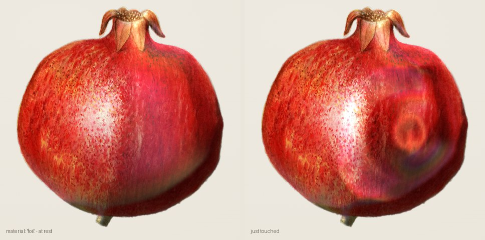 | 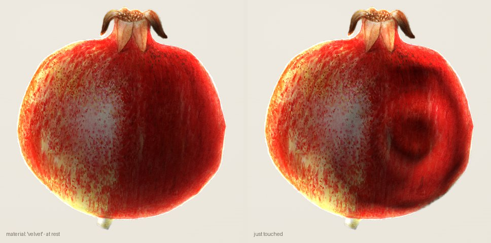 |
| `material: 'foil'`, at rest and just touched | `material: 'velvet'` |
| 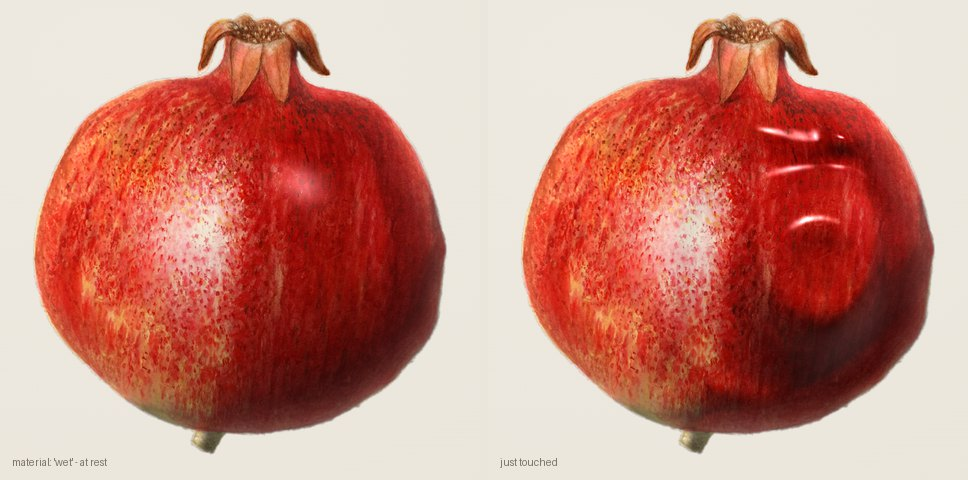 | 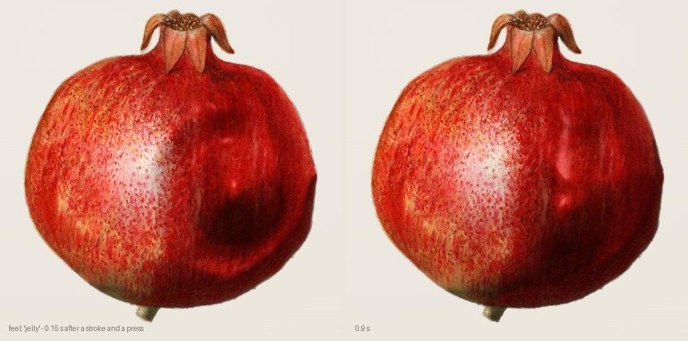 |
| `material: 'wet'` | `feel: 'jelly'`, 0.15 s and 0.9 s after a touch |

**[Open the Lab →](https://russguo.github.io/silkify/examples/lab.html)** Every option on one page: drag a slider and the object changes live, pick a `material` and a `feel`, press Touch or Stroke to see the feel without a mouse, hold B to compare with the defaults, drop in your own picture, then copy the options, share the link (the whole state is in the URL), or download the result as one HTML file that opens with a double-click, the picture inside it (that file loads silk.js and three.js from jsDelivr). One picture per preset is in [docs/shots/lab](docs/shots/lab).

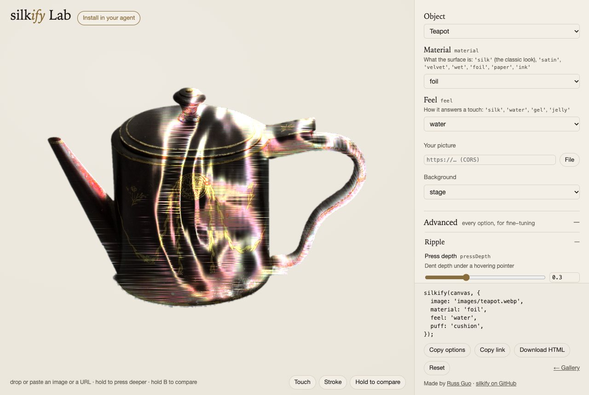

<details>
<summary>Every option at a glance</summary>

<br>

| Group | Options (defaults) |
|---|---|
| Presets | `material` (`'silk'`) · `feel` (`'silk'`) |
| Ripple | `pressDepth` 0.30 · `pressDepthHold` 0.60 · `pressRadius` 0.075 · `waveSpeed` 1.6 · `damping` 0.996 · `displace` 0.32 · `ripple` 62 |
| Material | `sheen` 0.18 sphere / 0.3 image · `sheenPower` 22 / 16 · `sheenColor` `[0.9,0.95,1]` · `satin` 0.9 · `albedo` null or `[r,g,b]` · `grain` 0 · `grainScale` 1 · `gamma` 1 · `exposure` 1 · `metallic` 0 · `anisotropy` 0 · `anisotropyAngle` 0 · `threads` 0 · `rim` 0 · `rimPower` 3 · `rimColor` `[1,1,1]` or null · `iridescence` 0 · `silkRest` 0 · `silkSpread` 1 |
| Light | `light` (view-space key light) · `lightColor` `[1,1,1]` · `satinLight` `[0.5,0.6,0.45]` · `floor` 0.05 / 0.55 · `volume` 0.28 · `fillLight` true · `idleSweep` true |
| Motion | `autoplay` false or `{ interval, depth, radius }` · `breeze` 0 · `handle.ripple(x, y)` |
| Shape (image) | `puff` `'dome'` / `'cushion'` / `'flat'` / a number · `matte` `'auto'` / `'alpha'` / `'rect'` · `corner` 0.06 · `threshold` 0.5 · `fit` 1.3 |
| Shape (sphere) | `phase` null or 0–1 · `bump` (elevation map) · `bumpStrength` 7 · `spin` true · `spinSpeed` 0.006 · `angle` 0 |
| Live HTML | `element` (an element or a selector, instead of `image`) · `fit` defaults to 1:1 · `puff` `'cushion'` |
| Runtime | `interactive` true · `tier` `'auto'` / `'high'` / `'low'` / `'static'` · `worker` `'auto'` / false · `threeUrl` · `poster` · `dpr` (per tier) · `reducedMotion` `'auto'` · `onHover` |

[references/parameters.md](references/parameters.md) explains what each option does and how to tune it and gives recipes for logos, photos, paintings and the moon; [references/troubleshooting.md](references/troubleshooting.md) has the fixes.

</details>

## Gallery

Every frame below is a real headless-Chrome render of [`examples/index.html`](examples/index.html), recorded by [`scripts/shoot.mjs`](scripts/shoot.mjs). The left column shows the object untouched. The right column is a 2.8-second loop: a pointer stroke, a short press, then the ripples dying away. Try it yourself in the [live gallery](https://russguo.github.io/silkify/examples/).

| | at rest | touched (2.8 s loop) |
|---|---|---|
| **Mona Lisa**: as a silk cushion | 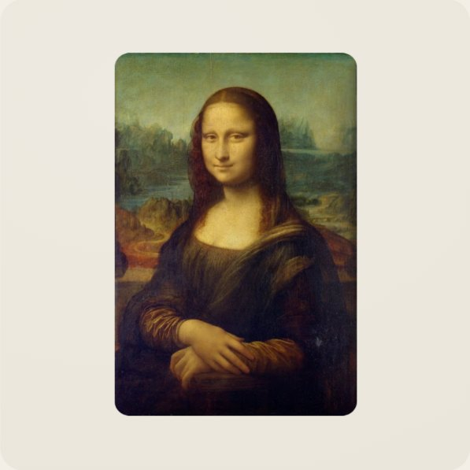 | 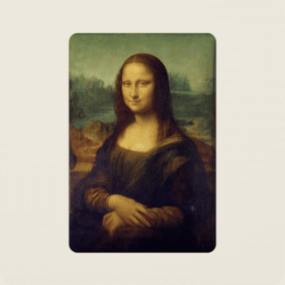 |
| **Pomegranate**: USDA watercolour, 1920 | 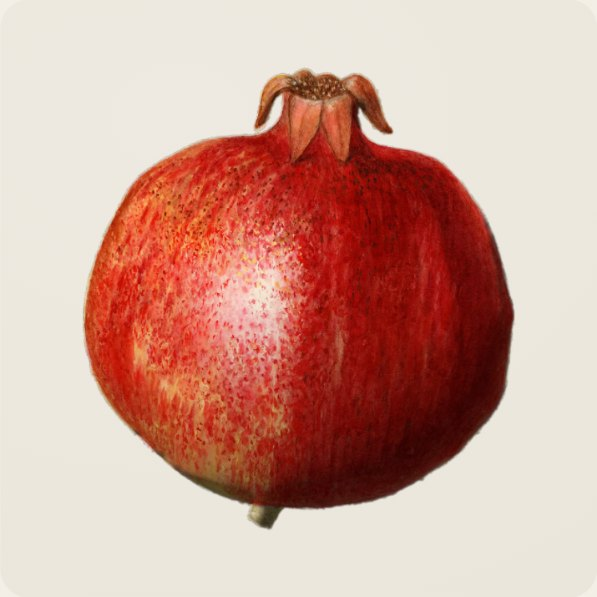 | 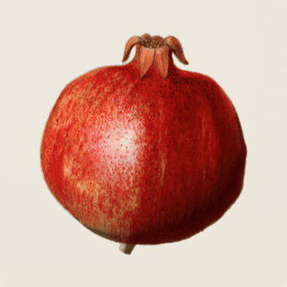 |
| **The Moon**: NASA LRO maps on a sphere, waxing gibbous | 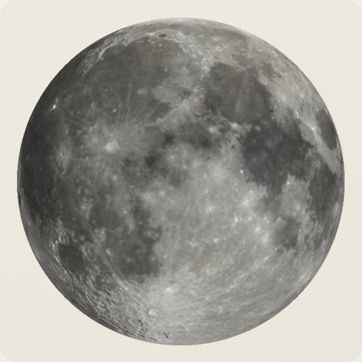 | 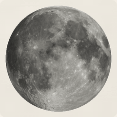 |
| **Young Hare**: Albrecht Dürer, 1502 | 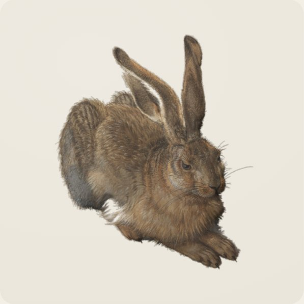 | 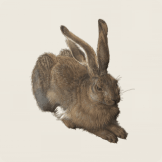 |
| **Teapot**: tôle and wicker, England, c. 1800 | 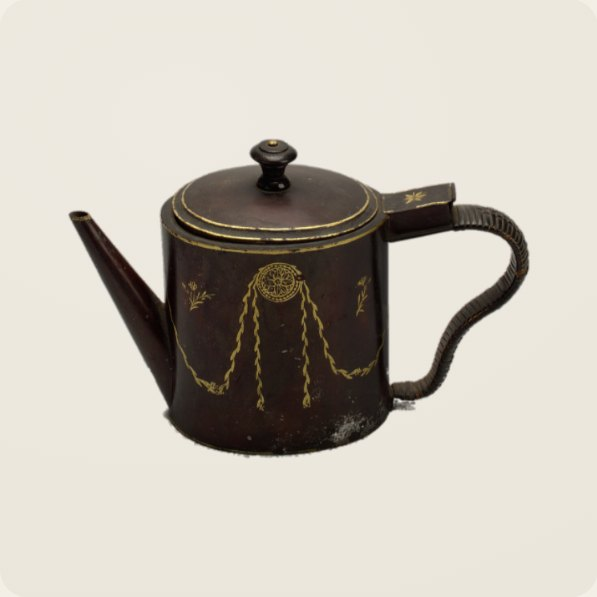 | 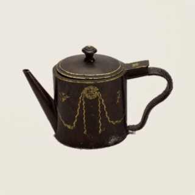 |
| **Portrait of a Man**: Rosalba Carriera, c. 1710 |  |  |
| **Bird figure**: gold, enamel and gemstones, India, possibly 18th century | 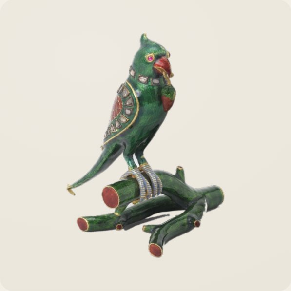 | 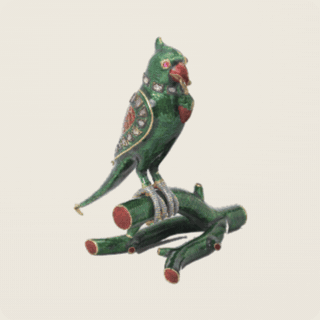 |
| **A drop of ink**: the FateTell mark, tinted ink with grain | 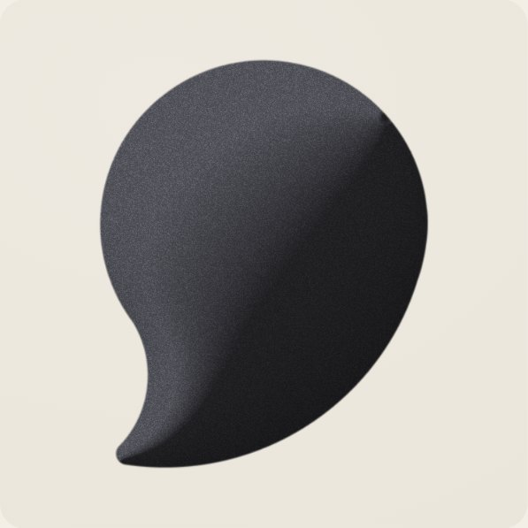 | 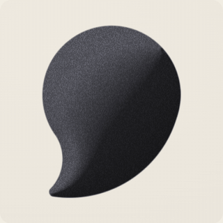 |

The images are public domain or CC0, except the FateTell mark, which is © FateTell and must be removed from forks; see [examples/CREDITS.md](examples/CREDITS.md). The left column is the gallery's poster: a still frame rendered by silkify itself. The GIFs are recorded in the high tier on the main thread, using SwiftShader, a software GPU. They are frame-stepped (three simulation steps per GIF frame at 20 fps), so the motion has the same timing as 60 fps on a real GPU. The GIF palette and the 320 px width soften the grain and the highlights.

To run the gallery yourself, serve the repository root and open `/examples/`:

```bash
npx serve .            # or: python3 -m http.server
```

## Live HTML

A piece of the page can be the silk instead of a picture. With HTML-in-Canvas (Chrome 157 and later), silkify prints a real element on the silk, and it stays HTML: select its words and copy them, find them with the browser's search, follow its links, press its buttons, type into it, scroll it; screen readers read it as usual. Touch it and it dents and ripples like any other object. Try the last card of the [live gallery](https://russguo.github.io/silkify/examples/), or [examples/live.html](examples/live.html).

| | |
|---|---|
| 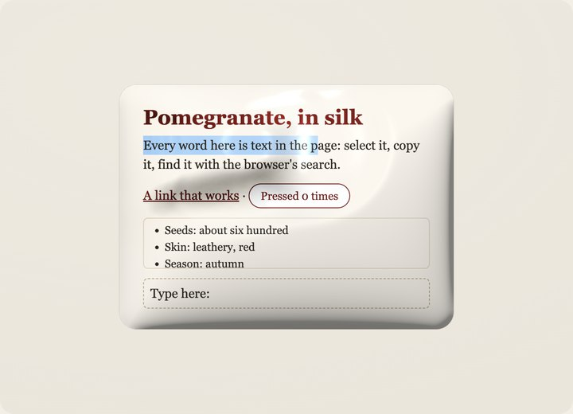 | 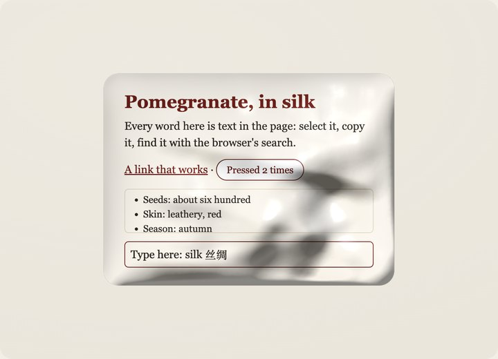 |
| Chrome 157, a real GPU: words selected on the silk | The same card touched, after typing into its last line |

<details>
<summary>The code, and what to know before you use it</summary>

<br>

```html
<div style="position: relative; display: grid; place-items: center; min-height: 480px">
  <canvas id="silk" style="position: absolute; inset: 0; width: 100%; height: 100%"></canvas>
  <article id="card" style="position: relative; box-sizing: border-box; width: min(420px, 100% - 32px); padding: 24px; border-radius: 20px; background: #fbf7ef">…</article>
</div>
<script type="importmap">
  { "imports": { "three": "./node_modules/three/build/three.module.js" } }
</script>
<script type="module">
  import { silkify } from './silk/silk.js';
  silkify(document.getElementById('silk'), { element: '#card' });
</script>
```

- **Browsers.** Live HTML needs HTML-in-Canvas, which Chrome ships from version 157. silkify detects the feature itself, never the browser's name. Everywhere else (Safari, Firefox, older Chrome), and with reduced motion, the element simply stays where it is as plain HTML: nothing to write for the fallback, and nothing logged.
- **1:1.** The element is drawn at its own size, in the place the page laid it out, and an invisible box of its size keeps that place in the page, so the fallback and the live card look the same and nothing moves when it comes alive. An element larger than its canvas is shrunk to fit, and one `console.warn` says so; pass `fit` to scale it like a picture, without a warning.
- **Its own box is the outline.** The element's background and `border-radius` become the silk's shape; `matte`, `threshold`, `corner`, `albedo`, `grain` and `poster` are ignored. `material`, `feel` and every light and ripple option apply; `puff` defaults to `'cushion'`.
- **It costs nothing at rest.** The element is printed again only when its rendering changes (text, style, hover, selection, the caret), each time one snapshot and one frame (`stats().mode` is then `'html'`, and `'rest'` once nothing has changed for a second), measured at about 2 ms of GPU work on a real GPU, 5 ms at the 90th percentile ([references/performance.md](references/performance.md)).
- **Accessibility.** The element stays in the page's accessibility tree. While it is inside the canvas, silkify removes any `aria-hidden` from the canvas, which would otherwise hide the element too, and puts it back afterwards.
- **Limits.** The browser never paints cross-origin images or iframes, `:visited` styles or spelling marks into the picture; the input method's candidate window is the system's own, placed by the browser. Keep continuous animation out of the element (every frame of it would be a snapshot). Style the element by its own id or class, since it moves into the canvas while live, and leave `user-select` alone on the canvas. A `position: fixed` child is placed against the canvas while live and against the viewport in the fallback, so the two differ: keep fixed children out of the element.

React and Next.js: `SilkHtml` in [examples/react](examples/react/src/SilkHtml.jsx) renders its children on the silk. The rules are in [SKILL.md](SKILL.md#step-5-optional-live-html-instead-of-a-picture).

</details>

## Browsers and fallbacks

- **Live wherever there is WebGL2, off the main thread.** By default, silkify renders inside a Web Worker on an OffscreenCanvas, so three.js, picture decoding, the Poisson solve, shader compilation and every frame stay off the main thread; where workers cannot render, it falls back to the main thread. It is not small on the wire: the first object to go live loads all of three.js (1.2 MB, about 240 KB compressed), from your own server or bundle, or from the CDN if you chose that way.
- **Still where motion is unwelcome.** Without WebGL2, with reduced motion asked for, with Save-Data or on a very small device, the visitor sees one still frame. On a phone, a tap or a sideways stroke, in the low tier; a vertical swipe scrolls the page (see `touch-action` in [SKILL.md](SKILL.md#step-4-render-it)).
- **What it is not.** Not a video or GIF maker: it is live WebGL on a web page; the GIFs above are screen recordings made by a script in this repository. Not a 3D model: the outline is inflated into a relief seen from the front, a cushion rather than a statue: it cannot be turned around (the moon is the one real sphere). Not a background remover: a photo of a subject on a busy background needs a cut-out PNG first; [cutout.py](scripts/cutout.py) only keys out plain backdrops.

## More

- [Parameters](references/parameters.md): every option, the presets, recipes from the gallery
- [Performance](references/performance.md): tiers, when the loop sleeps, many objects on a page, measurements
- [Troubleshooting](references/troubleshooting.md): symptom, cause and fix
- [Live HTML](SKILL.md#step-5-optional-live-html-instead-of-a-picture): the rules, in SKILL.md step 5
- [How it works](references/how-it-works.md): from a picture to silk, and what it costs
- [Contributing](CONTRIBUTING.md): the rules for a change, and the repository's layout
- [Changelog](CHANGELOG.md): what changed in each release, and what a version tag promises

## Credits

The silk material and the wave-and-light pipeline began as the "silk moon" on the author's personal site. This repository generalises it to any silhouette by adding Poisson inflation, an orthographic camera, displacement along the view axis and waves zeroed outside the outline. Moon data: NASA's Scientific Visualization Studio, CGI Moon Kit. Gallery images: see [examples/CREDITS.md](examples/CREDITS.md).

## License

The code is under the [MIT](LICENSE) license, © 2026 Guo Hao. The example images keep their own terms: public domain or CC0, except the FateTell mark, which is © FateTell, all rights reserved, and not covered by MIT (see the exception in [LICENSE](LICENSE) and [CREDITS](examples/CREDITS.md)).
