[English](README.md) | 简体中文


# silkify

<p><!-- byline -->作者：<a href="https://github.com/RussGuo">Russ Guo</a><!-- /byline --></p>

<p>
  <a href="https://russguo.github.io/silkify/examples/"><b>在线画廊 →</b></a> &nbsp;·&nbsp;
  <a href="https://russguo.github.io/silkify/examples/lab.html">Lab 调参页</a> &nbsp;·&nbsp;
  <a href="https://russguo.github.io/silkify/examples/how-it-works.zh.html">原理</a> &nbsp;·&nbsp;
  <a href="#一句话安装">装进你的 Agent</a> &nbsp;·&nbsp;
  <a href="SKILL.md">SKILL.md</a> &nbsp;·&nbsp;
  <a href="CHANGELOG.md">v0.3.0</a> &nbsp;·&nbsp;
  <a href="LICENSE">MIT</a>
</p>

**万物皆可丝绸化。** silkify 把一张图片、一个词，或者网页的一部分，变成网页上可以触碰的丝绸物体：静止时是哑光的实物照片，指针碰到的地方被压出凹坑，涟漪荡开，泛起缎面的光泽。

它由两部分组成：一个小巧的 WebGL 库（基于 [three.js](https://threejs.org) 的一个 ES module），和一个 [Agent Skill](SKILL.md)。后者教任何编码 Agent 抠图、把轮廓吹成穹面，再嵌进任意页面。

## 一句话安装

把下面这句话复制给你的编码 Agent（Claude Code、Codex、Cursor、Copilot、Gemini CLI，或者别的能装 skill 的 Agent），它会自己把 silkify 装好：

<!-- install: written by scripts/build-integrations.mjs; change it there -->
```text
安装 silkify 这个 Agent Skill：用 git clone --depth 1 --branch v0.3.0 https://github.com/RussGuo/silkify 把它克隆到你读取 skill 的目录里，文件夹就叫 silkify（Claude Code 是 ~/.claude/skills，Codex、Cursor、GitHub Copilot、Gemini CLI 和大多数其他 Agent 是 ~/.agents/skills），然后读一遍它的 SKILL.md，告诉我装好没有。
```

装好之后，跟它说「把这张图丝绸化」就行。Skill 会把 `src/` 拷进你的项目，页面不依赖任何外部服务；实在没有地方放文件，也可以改走 CDN。要是你的 Agent 装不了 skill，也照样能用：把 [SKILL.md](SKILL.md) 原文贴给它，或者让它去读 [llms.txt](llms.txt)。

<details>
<summary>各家 Agent 从哪里读 skill</summary>

<br>

silkify 是一个 [Agent Skill](https://agentskills.io)：只有一份 [SKILL.md](SKILL.md)，从抠图到做出成品页面，任何编码 Agent 照着走一遍就行。

| Agent | 安装 |
|---|---|
| Claude Code | clone 到 `~/.claude/skills/silkify`；或者 `/plugin marketplace add RussGuo/silkify`，再 `/plugin install silkify@silkify` |
| Codex（CLI、IDE 插件）与 ChatGPT 桌面端 | `git clone --depth 1 https://github.com/RussGuo/silkify ~/.agents/skills/silkify` |
| Cursor | 同一条 clone（Cursor 读取 `~/.agents/skills`），或把 [`integrations/cursor/silkify.mdc`](integrations/cursor/silkify.mdc) 放进 `.cursor/rules/` |
| GitHub Copilot | 同一条 clone（Copilot 读取 `~/.agents/skills`）；只给某个仓库用时，把 [`integrations/copilot/silkify.instructions.md`](integrations/copilot/silkify.instructions.md) 放进 `.github/instructions/`（只作用于页面与组件文件） |
| Gemini CLI | 同一条 clone（`~/.agents/skills` 是 `~/.gemini/skills` 的别名） |
| OpenCode、Amp 等支持 Skill 的 Agent | 同一条 clone，或 `npx skills add RussGuo/silkify` |
| 其他 | 把 [SKILL.md](SKILL.md) 原文贴进对话，或让 Agent 读 [llms.txt](llms.txt) |

上面那句话用 `--branch` 把版本钉在当前发布版上；去掉它就一直跟着 `main` 走（每个版本改了什么，看 [CHANGELOG.md](CHANGELOG.md)）。多数 Agent 要新开一个会话才会认出新装的 skill。Cursor、Copilot 用的文件以及 [AGENTS.md](AGENTS.md)、[llms.txt](llms.txt) 都是 `npm run build:integrations` 从 SKILL.md 生成的，所以不管用哪个 Agent，读到的都是同一份说明。

</details>

## 30 秒上手

先把 `src/` 文件夹拷进项目，起名 `silk/`，再装上 three（`npm i three`），然后：

```html
<canvas id="pear" style="width: 420px; aspect-ratio: 1"></canvas>
<canvas id="moon" style="width: 420px; aspect-ratio: 1"></canvas>

<script type="importmap">
  { "imports": { "three": "./node_modules/three/build/three.module.js" } }
</script>
<script type="module">
  import { silkify } from './silk/silk.js';

  silkify(document.getElementById('pear'), { image: 'pear.png' });            // 任意透明底 PNG
  silkify(document.getElementById('moon'), { image: 'moon.png', shape: 'sphere' });   // 等距圆柱投影贴图
</script>
```

没地方放文件（比如 CodePen、只有一个 HTML 文件）？那就改成从 `https://cdn.jsdelivr.net/gh/RussGuo/silkify@v0.3.0/src/silk.js` 引入，`three` 映射到 `https://cdn.jsdelivr.net/npm/three@0.152.2/build/three.module.js`；这样页面就得靠 jsDelivr 了（细节见 [SKILL.md](SKILL.md#get-the-code)）。

- **图片没有透明底？** 运行 `python3 scripts/cutout.py photo.jpg out.png` 抠掉纯色背景；或者保留整张矩形，让 silkify 把它做成软垫。
- **想用文字而不是图片？** `silkify(canvas, { text: 'silk', font: '800 200px Georgia, serif' })` 就能把一个词、一行标题或一个 emoji 变成丝绸，不用抠图。可以打开 [examples/text.html](examples/text.html) 试试，参数见 [references/parameters.md](references/parameters.md#text-words-as-the-object)（英文）。这是 `main` 上的新功能：在 [Lab 调参页](https://russguo.github.io/silkify/examples/lab.html) 里把物体（Object）选成 Words 就能试。
- **在 Agent 里用？** 见[一句话安装](#一句话安装)。

**用 React**（Next.js 也一样）：画布在 effect 里自己创建，不交给 React 渲染，因为 silkify 可能把它转交给 Worker。

```jsx
'use client';                                           // Next.js app router; harmless elsewhere
import { useEffect, useRef } from 'react';
import { silkify } from './silk/silk.js';               // src/ copied there; `npm i three`

export default function Silk({ src, options, className, style }) {
  const box = useRef(null);
  useEffect(() => {
    const canvas = document.createElement('canvas');    // made here, not by React: silkify may transfer or swap it
    canvas.style.cssText = 'display:block;width:100%;height:100%';
    box.current.append(canvas);
    const silk = silkify(canvas, { image: src, ...options });
    return () => { silk.dispose(); silk.canvas.remove(); };
  }, [src]);                                            // options are read once; use silk.setTheme() to change them live
  return <div ref={box} className={className} style={{ aspectRatio: '1', touchAction: 'pan-y', ...style }} aria-hidden />;
}
```

背后的规则见 [SKILL.md](SKILL.md#react-and-nextjs)；`examples/react` 和 `examples/next` 是能直接跑的工程。

`silkify()` 会立即返回一个句柄：

```js
const silk = silkify(canvas, options);
await silk.ready;                         // 实时渲染为 'webgl'，只画一帧为 'static'，失败为 'failed'（原因见 silk.reason）
silk.setTheme({ exposure: 0.9, floor: 0.4 });
silk.dispose();
```

## 融进页面

物体不只是会起涟漪。下面这些，多传一个参数或多引一个函数就有：

| | |
|---|---|
| **事件** | `onPress`、`onRelease`、`onStroke` 告诉页面指针去了哪里，精确到物体上的哪一点（`uv`）；`onReady`、`onFail` 告诉页面物体最后是活起来了还是没成。`haptics: true` 让支持的手机在按下时轻震一下。[事件说明 →](references/parameters.md#events-what-the-object-tells-the-page)（英文） |
| **丝绸按钮** | 一个真正的 `<button>`，按钮面是丝绸：能用 Tab 聚焦，Enter 和空格能按（按下时也起涟漪），读屏软件照常朗读。完整做法见 [examples/button.html](examples/button.html)。 |
| **一页很多个物体** | `pool()` 先让整页都是静态帧，谁被碰到谁才活起来，同一时间只活几个。`prewarm()` 在有人触碰之前先把 three.js 加载好，`coolDown()` 再把它放掉。[一页多个物体 →](references/performance.md)（英文） |
| **铺满整块区域** | `fit: 'cover'` 像 CSS 的 `object-fit: cover` 一样铺满画布，画布尺寸变了也跟着变。`poster` 可以是页面自己画出来的图；`breezeIdle` 让微风吹动的绸面在一段时间没人碰之后停下来歇着。[整幅绸面 →](https://russguo.github.io/silkify/examples/demos/fabric.html) |

## 材质与手感

大多数效果两个词就能定：`material`（`'silk'`、`'satin'`、`'velvet'`、`'wet'`、`'foil'`、`'paper'`、`'ink'`）决定表面是什么材料，`feel`（`'silk'`、`'water'`、`'gel'`、`'jelly'`）决定它被碰时怎么动，例如 `silkify(canvas, { image, material: 'foil', feel: 'water' })`。显式写出的参数永远优先于预设。想找自己的数值，用 [Lab 调参页](https://russguo.github.io/silkify/examples/lab.html)。

| | |
|---|---|
| 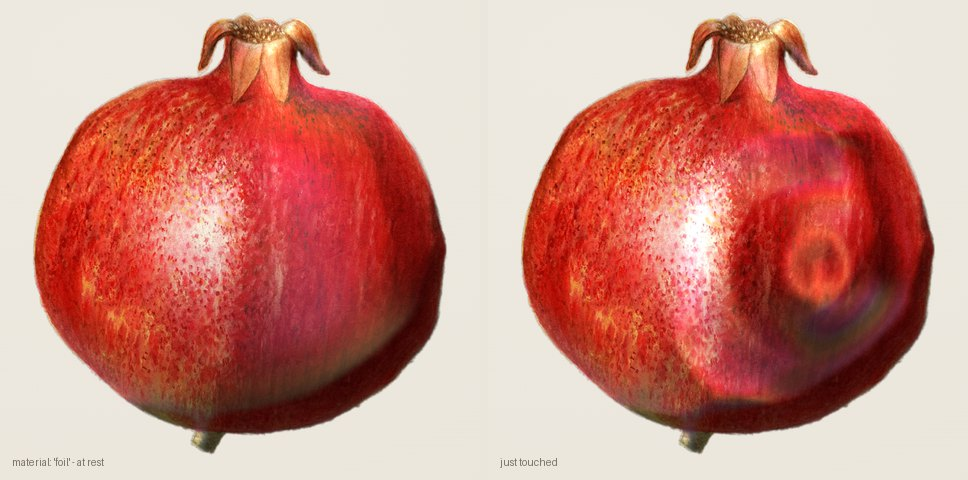 | 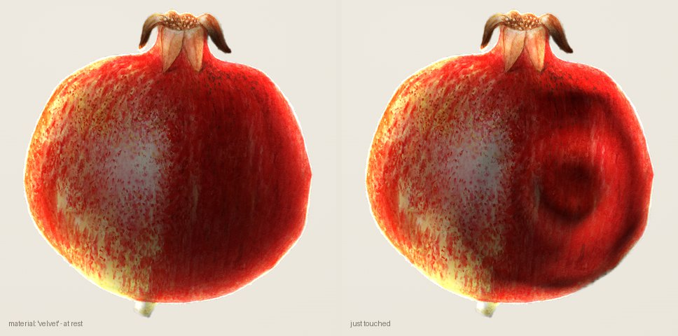 |
| `material: 'foil'`，左边静止，右边刚被触碰 | `material: 'velvet'` |
| 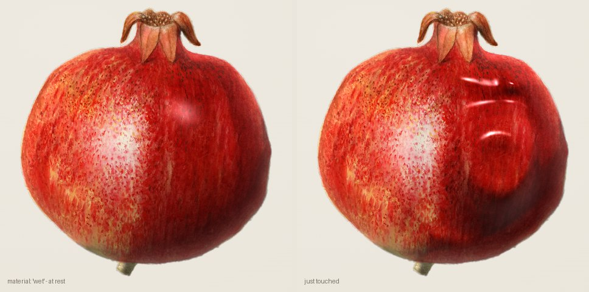 | 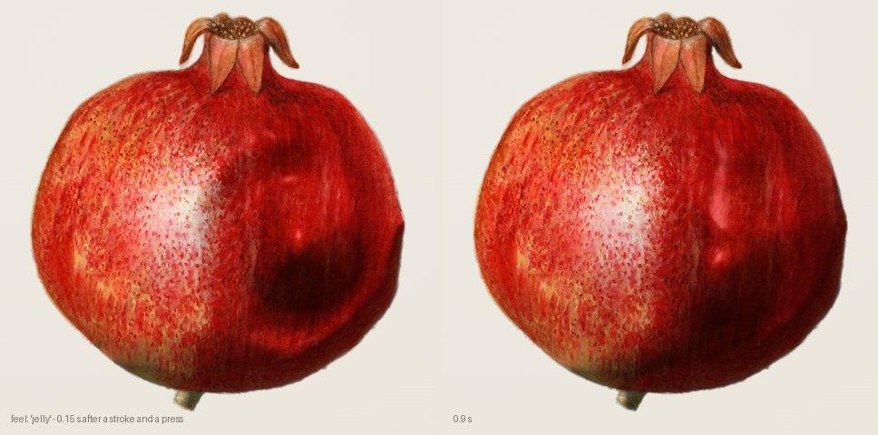 |
| `material: 'wet'` | `feel: 'jelly'`，触碰后 0.15 秒和 0.9 秒 |

**[打开 Lab 调参页 →](https://russguo.github.io/silkify/examples/lab.html)** 所有参数都在一页上：拖滑杆，物体当场变；选一个 `material` 和一个 `feel`；不动鼠标也能用 Touch / Stroke 看手感，按住 B 与默认对比；拖入自己的图片，或者干脆打几个字（Object → Words，系统字体或 Google Fonts 都行，有中文字体）；再一键复制参数、分享链接（完整状态都在网址里），或者下载成一个双击就能打开的 HTML 文件（图片内嵌在文件里，silk.js 和 three.js 从 jsDelivr 加载）。**Record** 能录一段 3 秒或 5 秒的短片拿去发：方形或 9:16，按浏览器存成 MP4 或 WebM，角落有个小小的 silkify 标记，点一下就能去掉。每个预设的效果图在 [docs/shots/lab](docs/shots/lab)。

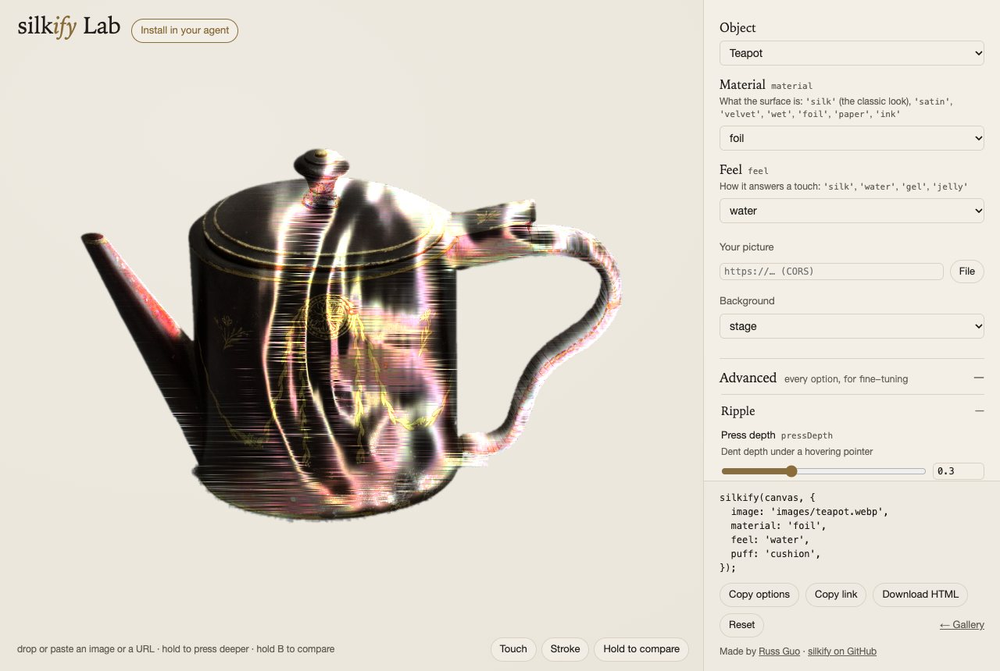

<details>
<summary>全部参数一览</summary>

<br>

| 分组 | 参数（默认值） |
|---|---|
| 预设 | `material`（`'silk'`）· `feel`（`'silk'`） |
| 涟漪 | `pressDepth` 0.30（凹坑深度）· `pressDepthHold` 0.60（按住时）· `pressRadius` 0.075（半径）· `waveSpeed` 1.6（波速）· `damping` 0.996（阻尼）· `displace` 0.32（位移）· `ripple` 62（涟漪的明暗对比） |
| 材质 | `sheen` 球体 0.18 / 图片 0.3（高光）· `sheenPower` 22 / 16 · `sheenColor` `[0.9,0.95,1]`（高光颜色）· `satin` 0.9（缎面）· `albedo` null 或 `[r,g,b]`（反照率）· `grain` 0（颗粒）· `grainScale` 1（颗粒尺寸）· `gamma` 1 · `exposure` 1（曝光）· `metallic` 0（金属感）· `anisotropy` 0（各向异性）· `anisotropyAngle` 0（丝线方向）· `threads` 0（丝线纹理）· `rim` 0（轮廓光）· `rimPower` 3 · `rimColor` `[1,1,1]` 或 null（取图片本色）· `iridescence` 0（虹彩）· `silkRest` 0（静止时的丝绸程度）· `silkSpread` 1（丝绸扩散范围） |
| 光 | `light`（视空间主光方向）· `lightColor` `[1,1,1]`（主光颜色）· `satinLight` `[0.5,0.6,0.45]`（缎面与高光的光向）· `floor` 0.05 / 0.55（背光面的最低亮度）· `volume` 0.28（明暗体积感）· `fillLight` true（补光跟随指针）· `idleSweep` true（闲置时补光慢慢扫一圈） |
| 动作 | `autoplay` false 或 `{ interval, depth, radius }`（定时自动落一滴）· `breeze` 0（微风）· `breezeIdle` 0（多少毫秒没人碰就停下微风）· `handle.ripple(x, y)`（程序化触碰一次） |
| 形状（图片） | `puff` `'dome'` / `'cushion'` / `'flat'` / 数值（鼓起的高度）· `matte` `'auto'` / `'alpha'` / `'rect'` · `corner` 0.06 · `threshold` 0.5 · `fit` 1.3 或 `'cover'`（铺满画布） |
| 形状（球体） | `phase` null 或 0–1（月相）· `bump`（高程图）· `bumpStrength` 7 · `spin` true · `spinSpeed` 0.006 · `angle` 0 |
| 文字 | `text`（代替 `image`）· `font` 默认 `800 160px` 加画布自己的字体 · `color` 默认取画布的 CSS 颜色 · `lineHeight` 1.15（行距） |
| 活 HTML | `element`（元素或选择器，代替 `image`）· `fit` 默认 1:1 · `puff` `'cushion'` |
| 事件 | `onPress` · `onRelease` · `onStroke` · `onHover` · `onReady` · `onFail` · `haptics` false（按下时轻震） |
| 运行 | `interactive` true · `tier` `'auto'` / `'high'` / `'low'` / `'static'`（档位）· `worker` `'auto'` / false · `threeUrl` · `poster`（静态帧：图片地址、canvas，或一个画出静态帧的函数）· `dpr`（像素比上限，按档位）· `reducedMotion` `'auto'` |

除了 `silkify()`，`silk.js` 还导出 `prewarm()` 和 `coolDown()`，`pool.js` 导出 `pool()`（见[导出](references/parameters.md#exports)，英文）。

每个参数的作用与调法、logo / 照片 / 绘画 / 月球的配方在 [references/parameters.md](references/parameters.md)，常见问题排查在 [references/troubleshooting.md](references/troubleshooting.md)。

</details>

## 画廊

下面每一帧都是 [`examples/index.html`](examples/index.html) 在无头 Chrome 里的真实渲染，由 [`scripts/shoot.mjs`](scripts/shoot.mjs) 录制。左列是未被触碰的静止状态，右列是 2.8 秒的循环：指针划过、短按一下、涟漪慢慢消退。想亲手摸一摸，请打开[在线画廊](https://russguo.github.io/silkify/examples/)。

| | 静止 | 触碰（2.8 秒循环） |
|---|---|---|
| **蒙娜丽莎**：做成丝绸软垫 | 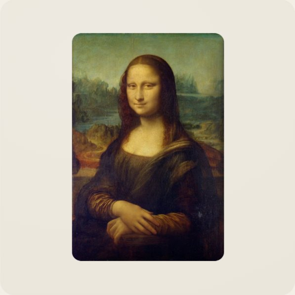 | 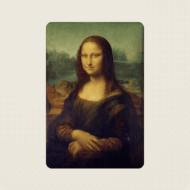 |
| **石榴**：美国农业部果树水彩，1920 | 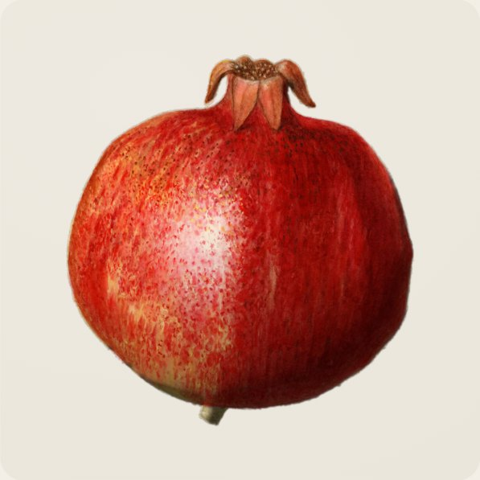 | 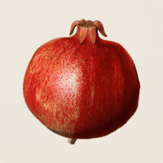 |
| **月球**：NASA LRO 色彩与高程图贴在球面上，盈凸月 | 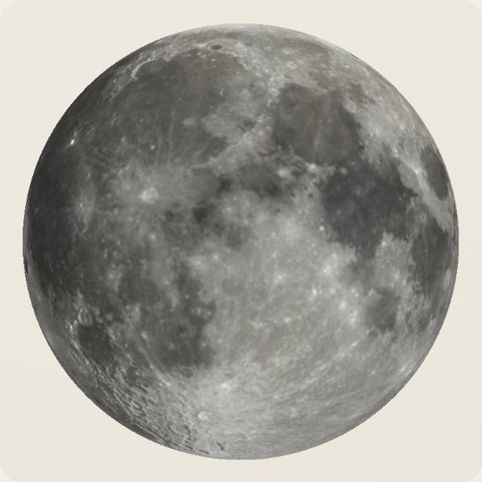 | 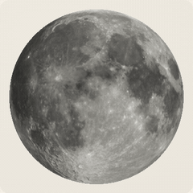 |
| **野兔**：丢勒，1502 | 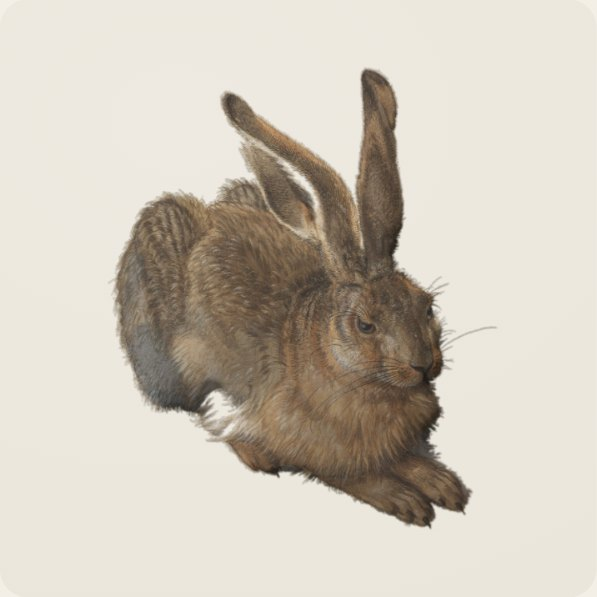 | 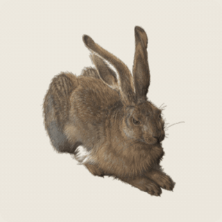 |
| **茶壶**：铁皮与藤编，英格兰，约 1800 | 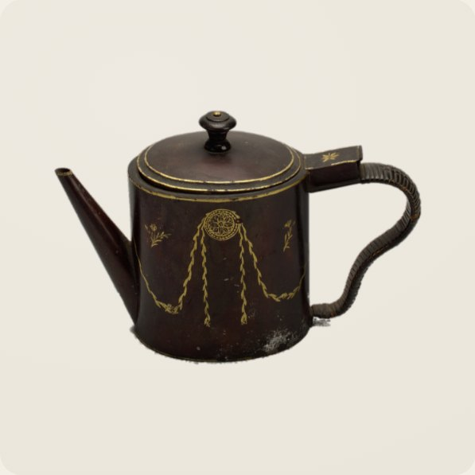 | 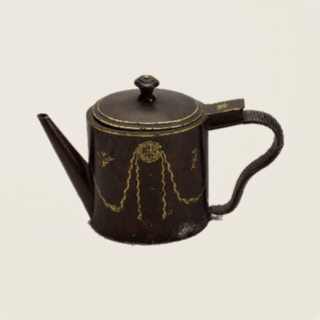 |
| **男子肖像**：罗萨尔芭·卡列拉，约 1710 | 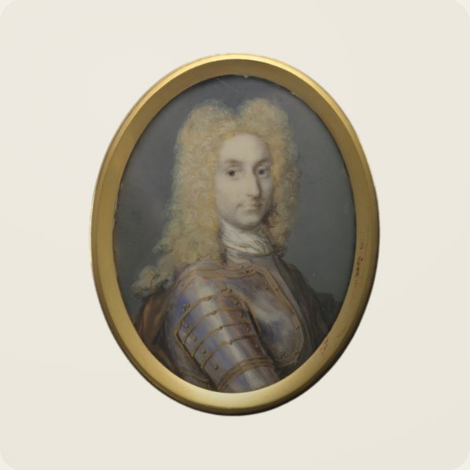 | 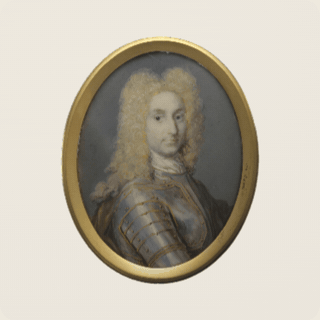 |
| **鸟形摆件**：黄金、珐琅与宝石，印度，可能为 18 世纪 | 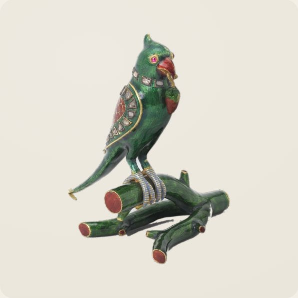 | 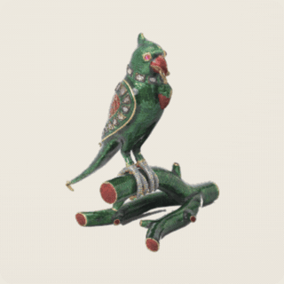 |
| **一滴墨**：FateTell 标识，墨色加细颗粒 | 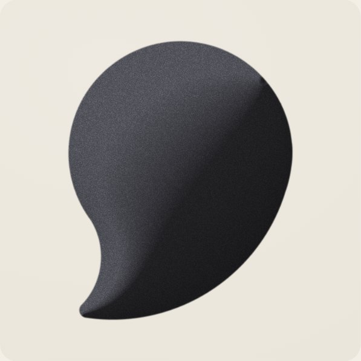 | 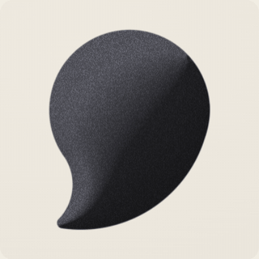 |
| **一个词，金箔**：没有图片，用 Fraunces Black 排出的一个词 | 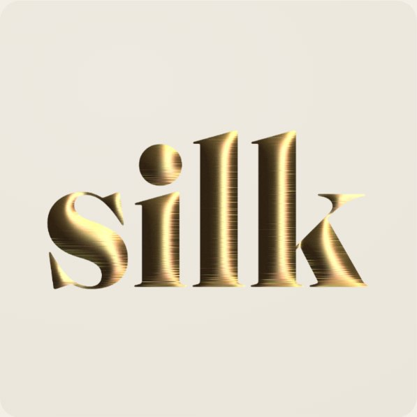 |  |

示例图片均为公有领域或 CC0，FateTell 标识除外：它 © FateTell，fork 时须移除；来源与许可证见 [examples/CREDITS.md](examples/CREDITS.md)。左列是画廊的静态帧，由 silkify 自己渲染。GIF 是用软件 GPU（SwiftShader）在高档、主线程上逐帧录的：每一帧对应三步模拟，按 20 fps 播放，节奏等同真 GPU 上的 60 fps。受 GIF 调色板和 320 像素宽度所限，颗粒和高光会比实际柔和一些。

在本地运行画廊：在仓库根目录起一个静态服务器，再打开 `/examples/`。

```bash
npx serve .            # 或：python3 -m http.server
```

## 活 HTML

印在丝绸上的也可以是页面里的一段 HTML，而不是一张图片。在支持 HTML-in-Canvas 的浏览器里（Chrome 157 起），silkify 把一个真实的元素印在绸面上，它仍然是 HTML：字能选中、复制，能被浏览器的查找找到，链接能点，按钮能按，能输入，能滚动，读屏软件照常朗读。摸一下，它照样凹陷、起涟漪。可以去[在线画廊](https://russguo.github.io/silkify/examples/)的最后一张卡片试，或者打开 [examples/live.html](examples/live.html)。

| | |
|---|---|
| 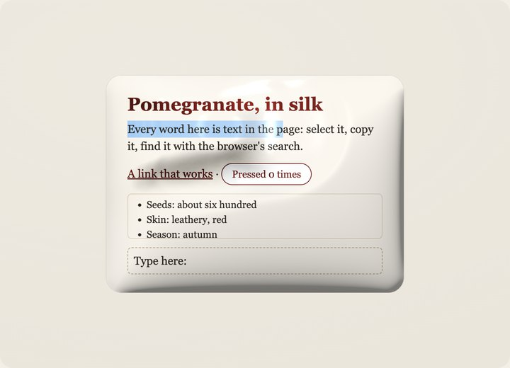 | 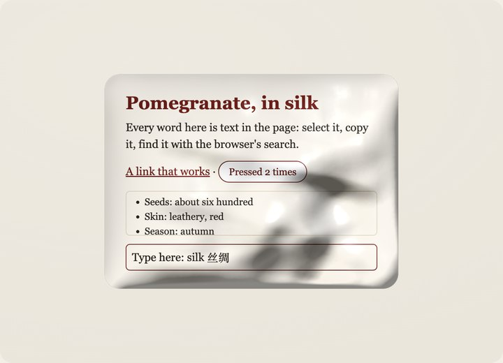 |
| Chrome 157，真 GPU：在绸面上选中文字 | 同一张卡片，在最后一行输入之后被触碰 |

<details>
<summary>代码，以及用之前要知道的事</summary>

<br>

```html
<div style="position: relative; display: grid; place-items: center; min-height: 480px">
  <canvas id="silk" style="position: absolute; inset: 0; width: 100%; height: 100%"></canvas>
  <article id="card" style="position: relative; box-sizing: border-box; width: min(420px, 100% - 32px); padding: 24px; border-radius: 20px; background: #fbf7ef">…</article>
</div>
<script type="importmap">
  { "imports": { "three": "./node_modules/three/build/three.module.js" } }
</script>
<script type="module">
  import { silkify } from './silk/silk.js';
  silkify(document.getElementById('silk'), { element: '#card' });
</script>
```

- **浏览器。** 活 HTML 需要 HTML-in-Canvas，Chrome 从 157 版开始提供。silkify 只检测这个特性本身，不看浏览器的名字。其他浏览器（Safari、Firefox、更早的 Chrome）里，以及系统开启了「减弱动态效果」时，元素就留在原处，是普通的 HTML：退路不用另写，控制台也不输出任何东西。
- **1:1。** 元素按自己的尺寸，画在页面排版给它的位置上；原处留着一个同样大小、看不见的占位，页面排版不变。所以退路和活起来的卡片看起来一样，活起来的那一刻不会跳动。元素比画布大时，会缩到能放下，并用一条 `console.warn` 说明。想放大或缩小，传 `fit`，它就像图片一样缩放，不会提示。
- **轮廓就是元素自己的盒子。** 元素的背景和 `border-radius` 就是绸面的形状；`matte`、`threshold`、`corner`、`albedo`、`grain`、`poster` 会被忽略。`material`、`feel` 以及所有光照和涟漪参数照常起作用；`puff` 默认为 `'cushion'`。
- **静止时零开销。** 只有元素的画面变了（文字、样式、悬停、选中、光标闪烁），才重新印一次：每次一张快照、一帧（这时 `stats().mode` 是 `'html'`，一秒内没有变化才回到 `'rest'`）。在真 GPU 上实测每次约 2 ms 的 GPU 工作，90 分位约 5 ms（见 [references/performance.md](references/performance.md)）。
- **无障碍。** 元素一直在页面的无障碍树里。元素在画布里的时候，silkify 会去掉画布上的 `aria-hidden`（否则元素也会被一起藏掉），之后再放回去。
- **限制。** 浏览器从不把跨源的图片和 iframe、`:visited` 样式、拼写标记画进快照；输入法的候选框是系统自己的窗口，由浏览器定位。不要在元素里放持续的动画（它的每一帧都是一张快照）。给元素用它自己的 id 或 class 写样式，因为活起来时它会被移进画布；画布上的 `user-select` 也不要关掉。元素里 `position: fixed` 的子元素，活起来时相对画布定位，退路下相对视口定位，两边位置不同，所以不要在元素里放固定定位的子元素。

React 和 Next.js：[examples/react](examples/react/src/SilkHtml.jsx) 里的 `SilkHtml` 会把它的子元素印在绸面上。规则见 [SKILL.md](SKILL.md#step-5-optional-live-html-instead-of-a-picture)。

</details>

## 浏览器与退路

- **有 WebGL2 的地方就实时渲染，而且不占主线程。** silkify 默认在 Web Worker 里的 OffscreenCanvas 上渲染，three.js 的执行、图片解码、泊松求解、着色器编译和每一帧的绘制都不占主线程；Worker 渲染不了就退到主线程。体积不小：第一个物体开始动之前，要先加载整个 three.js（1.2 MB，压缩后约 240 KB），从你自己的服务器或打包产物里加载，选了 CDN 就从 CDN 加载。
- **条件不够时只有一张静态图。** 没有 WebGL2、系统开启了「减弱动态效果」、开了省流量，或者设备太弱，访客看到的就是一张静止的图。手机上只能点按和横向划动，而且走的是轻量档；竖着划会滚动页面（见 [SKILL.md](SKILL.md#step-4-render-it) 里的 `touch-action`）。
- **它不是什么。** 不是视频或 GIF 生成器：它是网页上实时运行的 WebGL，上面的 GIF 是本仓库的脚本录下来的屏幕录像。不是 3D 模型：轮廓被吹鼓成一块从正面看的浮雕，更像软垫而不是雕塑，不能转到侧面去看（月球是唯一真正的球）。也不是抠图工具：背景杂乱的照片要先自己准备好抠好的 PNG，[cutout.py](scripts/cutout.py) 只能去掉纯色背景。

## 更多

- [参数](references/parameters.md)：每个参数、各个预设、画廊里用到的配方（英文）
- [性能](references/performance.md)：分档、什么时候停止渲染、一页多个物体、实测数据（英文）
- [常见问题](references/troubleshooting.md)：症状、原因与解决办法（英文）
- [活 HTML](SKILL.md#step-5-optional-live-html-instead-of-a-picture)：完整规则在 SKILL.md 第 5 步（英文）
- [原理](https://russguo.github.io/silkify/examples/how-it-works.zh.html)：一篇长文，图可以直接上手摸：Poisson 穹面、月亮的光、只在起涟漪的地方出现的缎光（短的版本在 [references/how-it-works.zh-CN.md](references/how-it-works.zh-CN.md)）
- [用例](examples/demos/)：四个可以直接拿去改的页面，每个都是一个 HTML 文件：[产品首屏](https://russguo.github.io/silkify/examples/demos/hero.html)、[Logo 墙](https://russguo.github.io/silkify/examples/demos/logo-wall.html)、[整幅绸面](https://russguo.github.io/silkify/examples/demos/fabric.html)、[404 页](https://russguo.github.io/silkify/examples/demos/404.html)
- [参与贡献](CONTRIBUTING.zh-CN.md)：改动要守的规矩，以及仓库结构
- [更新日志](CHANGELOG.md)：每个版本改了什么，以及版本 tag 承诺什么（英文）

## 致谢

丝绸材质以及「波动 + 光照」这条管线，最早是作者个人网站上的「丝绸月球」。本仓库把它推广到任意轮廓：加了泊松吹鼓、正交相机、沿视线方向的位移，以及轮廓外归零的波。月球数据来自 NASA Scientific Visualization Studio 的 CGI Moon Kit；画廊图片来源见 [examples/CREDITS.md](examples/CREDITS.md)。

## 许可证

代码采用 [MIT](LICENSE) 许可证，© 2026 Guo Hao。示例图片各自保留原有条款：除 FateTell 标识外，均为公有领域或 CC0；FateTell 标识 © FateTell 保留所有权利，不在 MIT 之内（见 [LICENSE](LICENSE) 末尾的例外条款与 [CREDITS](examples/CREDITS.md)）。

