[English](README.md) | 简体中文

# silkify

**[打开在线画廊 →](https://russguo.github.io/silkify/examples/)**

**万物皆可丝绸化。** silkify 把任意一张图片变成网页上可以触碰的丝绸物体：静止时是哑光的实物照片，指针碰到的地方被压出凹坑，涟漪荡开，泛起缎面的光泽。

它由两部分组成：一个小巧的 WebGL 库（基于 [three.js](https://threejs.org) 的一个 ES module），和一个 [Agent Skill](SKILL.md)。后者教任何编码 Agent 抠图、把轮廓吹成穹面，再嵌进任意页面。

## 它不是什么

- **不是视频或 GIF 生成器。** 它是网页上实时运行的 WebGL；下面的 GIF 是本仓库的脚本录下来的屏幕录像。
- **不是 3D 模型。** 轮廓被吹鼓成一块从正面看的浮雕，更像软垫而不是雕塑，不能转到侧面去看（月球是唯一真正的球）。
- **条件不够时只有一张静态图。** 没有 WebGL2、系统设置了减少动态效果、开了省流量，或者设备太弱，访客看到的就是一张静止的图。
- **手机上只能点按和横向划动**，而且走的是轻量档；竖着划会滚动页面（见 [SKILL.md](SKILL.md#step-4-render-it) 里的 `touch-action`）。
- **体积不小。** 第一个物体开始动之前，要先加载整个 three.js（1.2 MB，压缩后约 240 KB）：从你自己的服务器或打包产物里加载，选了 CDN 就从 CDN 加载。
- **不是抠图工具。** 背景杂乱的照片要先自己准备好抠好的 PNG；[cutout.py](scripts/cutout.py) 只能去掉纯色背景。

## 一句话安装

把下面这句话复制给你的编码 Agent（Claude Code、Codex、Cursor、Copilot、Gemini CLI，或者别的能装 skill 的 Agent），它会自己把 silkify 装好：

<!-- install: written by scripts/build-integrations.mjs; change it there -->
```text
安装 silkify 这个 Agent Skill：用 git clone --depth 1 --branch v0.2.3 https://github.com/RussGuo/silkify 把它克隆到你读取 skill 的目录里，文件夹就叫 silkify（Claude Code 是 ~/.claude/skills，Codex、Cursor、GitHub Copilot、Gemini CLI 和大多数其他 Agent 是 ~/.agents/skills），然后读一遍它的 SKILL.md，告诉我装好没有。
```

装好之后，跟它说「把这张图丝绸化」就行。Skill 会把 `src/` 拷进你的项目，页面不依赖任何外部服务；实在没有地方放文件，也可以改走 CDN。要是你的 Agent 装不了 skill，也照样能用：把 [SKILL.md](SKILL.md) 原文贴给它，或者让它去读 [llms.txt](llms.txt)。

<details>
<summary>各家 Agent 从哪里读 skill</summary>

<br>

silkify 是一个 [Agent Skill](https://agentskills.io)：只有一份 [SKILL.md](SKILL.md)，从抠图到做出成品页面，任何编码 Agent 照着走一遍就行。

| Agent | 安装 |
|---|---|
| Claude Code | clone 到 `~/.claude/skills/silkify`；或者 `/plugin marketplace add RussGuo/silkify`，再 `/plugin install silkify@silkify` |
| Codex（CLI、IDE 插件）与 ChatGPT 桌面端 | `git clone --depth 1 https://github.com/RussGuo/silkify ~/.agents/skills/silkify` |
| Cursor | 同一条 clone（Cursor 读取 `~/.agents/skills`），或把 [`integrations/cursor/silkify.mdc`](integrations/cursor/silkify.mdc) 放进 `.cursor/rules/` |
| GitHub Copilot | 同一条 clone（Copilot 读取 `~/.agents/skills`）；只给某个仓库用时，把 [`integrations/copilot/silkify.instructions.md`](integrations/copilot/silkify.instructions.md) 放进 `.github/instructions/`（只作用于页面与组件文件） |
| Gemini CLI | 同一条 clone（`~/.agents/skills` 是 `~/.gemini/skills` 的别名） |
| OpenCode、Amp 等支持 Skill 的 Agent | 同一条 clone，或 `npx skills add RussGuo/silkify` |
| 其他 | 把 [SKILL.md](SKILL.md) 原文贴进对话，或让 Agent 读 [llms.txt](llms.txt) |

上面那句话用 `--branch` 把版本钉在当前发布版上；去掉它就一直跟着 `main` 走（每个版本改了什么，看 [CHANGELOG.md](CHANGELOG.md)）。多数 Agent 要新开一个会话才会认出新装的 skill。Cursor、Copilot 用的文件以及 [AGENTS.md](AGENTS.md)、[llms.txt](llms.txt) 都是 `npm run build:integrations` 从 SKILL.md 生成的，所以不管用哪个 Agent，读到的都是同一份说明。

</details>

## 画廊

下面每一帧都是 [`examples/index.html`](examples/index.html) 在无头 Chrome 里的真实渲染，由 [`scripts/shoot.mjs`](scripts/shoot.mjs) 录制。左列是未被触碰的静止状态，右列是 2.8 秒的循环：指针划过、短按一下、涟漪慢慢消退。想亲手摸一摸，请打开[在线画廊](https://russguo.github.io/silkify/examples/)。

| | 静止 | 触碰（2.8 秒循环） |
|---|---|---|
| **一滴墨**：FateTell 标识，墨色加细颗粒 | 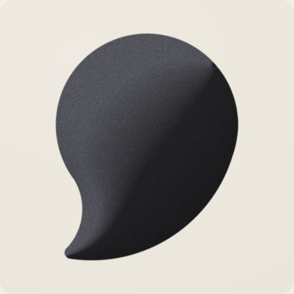 | 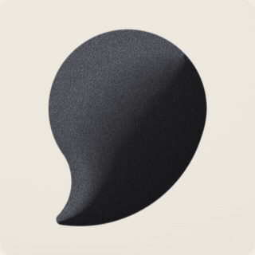 |
| **月球**：NASA LRO 色彩与高程图贴在球面上，盈凸月 | 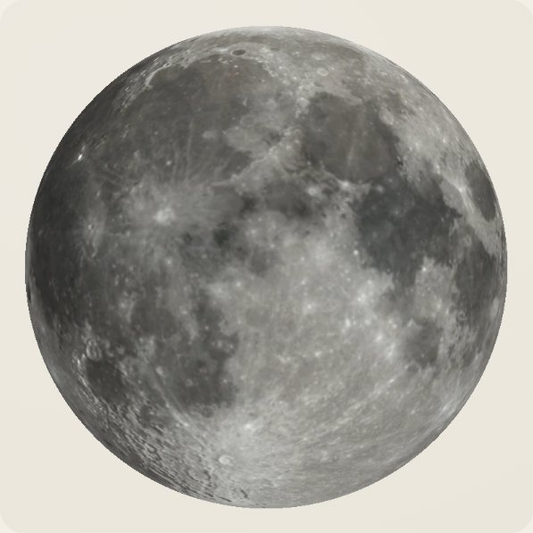 | 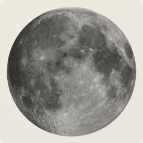 |
| **石榴**：美国农业部果树水彩，1920 | 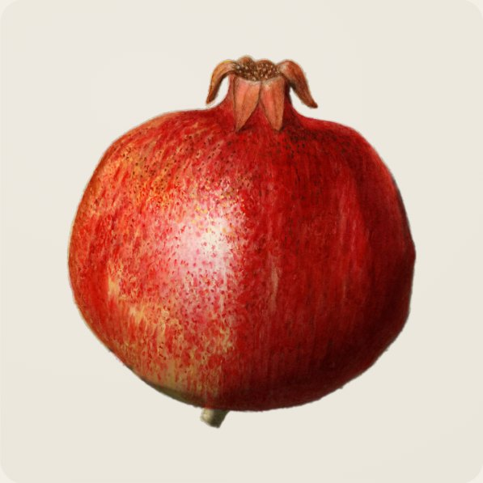 | 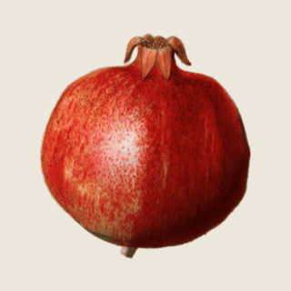 |
| **野兔**：丢勒，1502 | 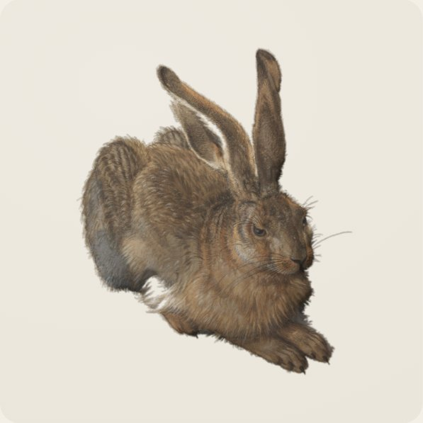 | 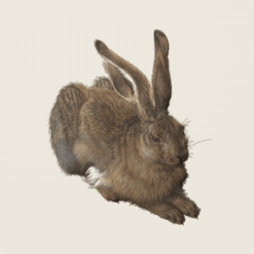 |
| **茶壶**：铁皮与藤编，英格兰，约 1800 | 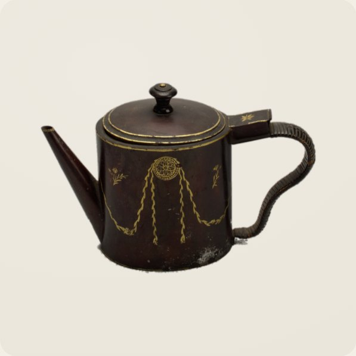 | 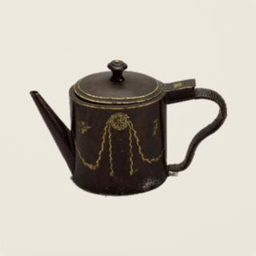 |
| **蒙娜丽莎**：做成丝绸软垫 | 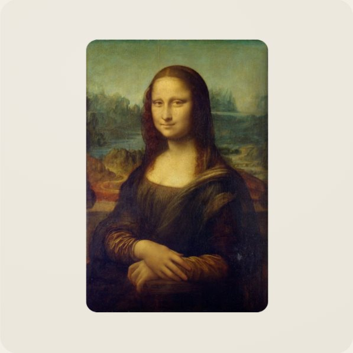 | 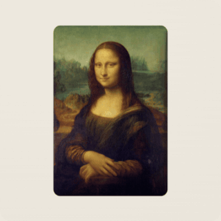 |
| **男子肖像**：罗萨尔芭·卡列拉，约 1710 | 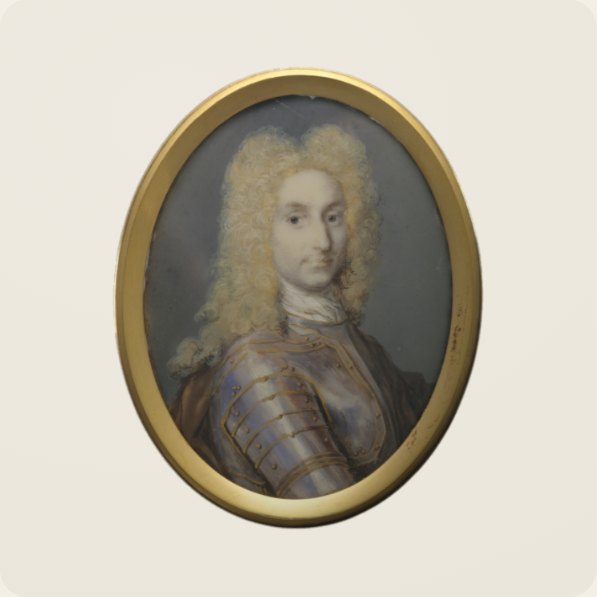 | 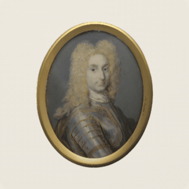 |
| **鸟形摆件**：黄金、珐琅与宝石，印度，可能为 18 世纪 | 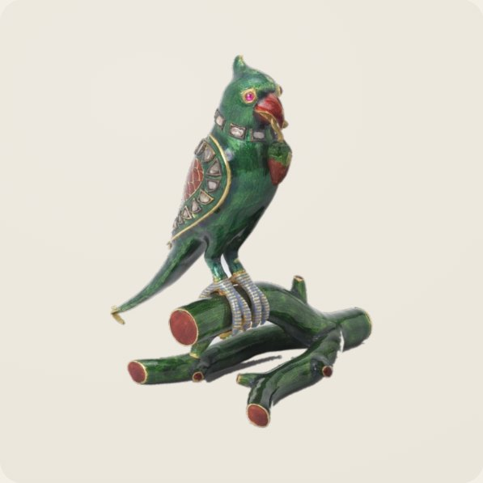 | 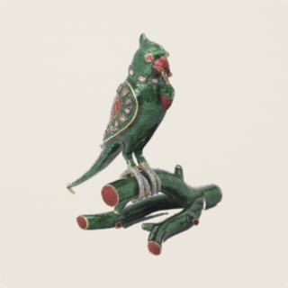 |

示例图片均为公有领域或 CC0，FateTell 标识除外：它 © FateTell，fork 时须移除；来源与许可证见 [examples/CREDITS.md](examples/CREDITS.md)。左列是画廊的静态帧，由 silkify 自己渲染。GIF 是用软件 GPU（SwiftShader）在高档、主线程上逐帧录的：每一帧对应三步模拟，按 20 fps 播放，节奏等同真 GPU 上的 60 fps。受 GIF 调色板和 320 像素宽度所限，颗粒和高光会比实际柔和一些。

**[打开 Lab 调参页 →](https://russguo.github.io/silkify/examples/lab.html)** 所有参数都在一页上：拖滑杆，物体当场变；选一个 `material` 和一个 `feel`；不动鼠标也能用 Touch / Stroke 看手感，按住 B 与默认对比；拖入自己的图片；再一键复制参数、分享链接（完整状态都在网址里），或者下载成一个双击就能打开的 HTML 文件（图片内嵌在文件里，silk.js 和 three.js 从 jsDelivr 加载）。每个预设的效果图在 [docs/shots/lab](docs/shots/lab)。

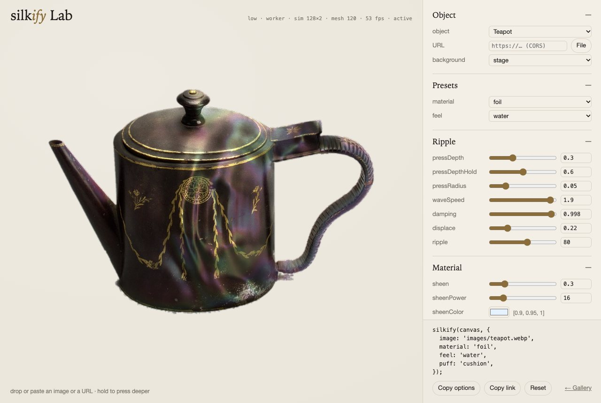

在本地运行画廊：在仓库根目录起一个静态服务器，再打开 `/examples/`。

```bash
npx serve .            # 或：python3 -m http.server
```

## 30 秒上手

先把 `src/` 文件夹拷进项目，起名 `silk/`，再装上 three（`npm i three`），然后：

```html
<canvas id="pear" style="width: 420px; aspect-ratio: 1"></canvas>
<canvas id="moon" style="width: 420px; aspect-ratio: 1"></canvas>

<script type="importmap">
  { "imports": { "three": "./node_modules/three/build/three.module.js" } }
</script>
<script type="module">
  import { silkify } from './silk/silk.js';

  silkify(document.getElementById('pear'), { image: 'pear.png' });            // 任意透明底 PNG
  silkify(document.getElementById('moon'), { image: 'moon.png', shape: 'sphere' });   // 等距圆柱投影贴图
</script>
```

没地方放文件（比如 CodePen、只有一个 HTML 文件）？那就改成从 `https://cdn.jsdelivr.net/gh/RussGuo/silkify@v0.2.3/src/silk.js` 引入，`three` 映射到 `https://cdn.jsdelivr.net/npm/three@0.152.2/build/three.module.js`；这样页面就得靠 jsDelivr 了（细节见 [SKILL.md](SKILL.md#get-the-code)）。

- **图片没有透明底？** 运行 `python3 scripts/cutout.py photo.jpg out.png` 抠掉纯色背景；或者保留整张矩形，让 silkify 把它做成软垫。
- **用 React？** 组件写法见 [SKILL.md](SKILL.md#react-and-nextjs)。
- **在 Agent 里用？** 见[一句话安装](#一句话安装)。

`silkify()` 会立即返回一个句柄：

```js
const silk = silkify(canvas, options);
await silk.ready;                         // 实时渲染为 'webgl'，只画一帧为 'static'，失败为 'failed'（原因见 silk.reason）
silk.setTheme({ exposure: 0.9, floor: 0.4 });
silk.dispose();
```

## 参数速查

大多数效果两个词就能定：`material`（`'silk'`、`'satin'`、`'velvet'`、`'wet'`、`'foil'`、`'paper'`、`'ink'`）决定表面是什么材料，`feel`（`'silk'`、`'water'`、`'gel'`、`'jelly'`）决定它被碰时怎么动，例如 `silkify(canvas, { image, material: 'foil', feel: 'water' })`。显式写出的参数永远优先于预设。想找自己的数值，用 [Lab 调参页](https://russguo.github.io/silkify/examples/lab.html)。

| 分组 | 参数（默认值） |
|---|---|
| 预设 | `material`（`'silk'`）· `feel`（`'silk'`） |
| 涟漪 | `pressDepth` 0.30（凹坑深度）· `pressDepthHold` 0.60（按住时）· `pressRadius` 0.075（半径）· `waveSpeed` 1.6（波速）· `damping` 0.996（阻尼）· `displace` 0.32（位移）· `ripple` 62（涟漪的明暗对比） |
| 材质 | `sheen` 球体 0.18 / 图片 0.3（高光）· `sheenPower` 22 / 16 · `sheenColor` `[0.9,0.95,1]`（高光颜色）· `satin` 0.9（缎面）· `albedo` null 或 `[r,g,b]`（反照率）· `grain` 0（颗粒）· `grainScale` 1（颗粒尺寸）· `gamma` 1 · `exposure` 1（曝光）· `metallic` 0（金属感）· `anisotropy` 0（各向异性）· `anisotropyAngle` 0（丝线方向）· `threads` 0（丝线纹理）· `rim` 0（轮廓光）· `rimPower` 3 · `rimColor` `[1,1,1]` 或 null（取图片本色）· `iridescence` 0（虹彩）· `silkRest` 0（静止时的丝绸程度）· `silkSpread` 1（丝绸扩散范围） |
| 光 | `light`（视空间主光方向）· `lightColor` `[1,1,1]`（主光颜色）· `satinLight` `[0.5,0.6,0.45]`（缎面与高光的光向）· `floor` 0.05 / 0.55（背光面的最低亮度）· `volume` 0.28（明暗体积感）· `fillLight` true（补光跟随指针）· `idleSweep` true（闲置时补光慢慢扫一圈） |
| 动作 | `autoplay` false 或 `{ interval, depth, radius }`（定时自动落一滴）· `breeze` 0（微风）· `handle.ripple(x, y)`（程序化触碰一次） |
| 形状（图片） | `puff` `'dome'` / `'cushion'` / `'flat'` / 数值（鼓起的高度）· `matte` `'auto'` / `'alpha'` / `'rect'` · `corner` 0.06 · `threshold` 0.5 · `fit` 1.3 |
| 形状（球体） | `phase` null 或 0–1（月相）· `bump`（高程图）· `bumpStrength` 7 · `spin` true · `spinSpeed` 0.006 · `angle` 0 |
| 运行 | `interactive` true · `tier` `'auto'` / `'high'` / `'low'` / `'static'`（档位）· `worker` `'auto'` / false · `threeUrl` · `poster`（静态图）· `dpr`（像素比上限，按档位）· `reducedMotion` `'auto'` · `onHover` |

每个参数的作用与调法、logo / 照片 / 绘画 / 月球的配方在 [references/parameters.md](references/parameters.md)，常见问题排查在 [references/troubleshooting.md](references/troubleshooting.md)。

## 原理

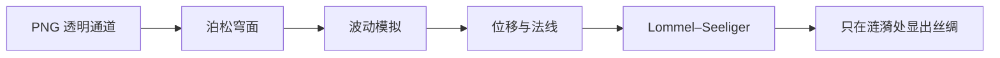

1. **轮廓 → 穹面。** 透明通道给出轮廓；不透明的图片当作圆角矩形。在轮廓内解泊松方程 ∇²u = −1（轮廓上 u = 0），高度取 2√u。对圆盘，这恰好是半球。细的部分鼓得低，中轴上也不会像距离场那样折出一道棱。月球跳过这一步，直接用真球。
2. **波动。** 阻尼波动方程在两张半浮点渲染目标上 ping-pong 交替运行：r 通道存高度，g 通道存速度。指针在上面压出凹坑。图片模式下轮廓外恒为零，所以波在轮廓处反射，轮廓本身永远不动。
3. **位移与法线。** 高度场推动表面：球体沿法线，图片沿视线方向，所以轮廓不会折叠。涟漪斜率叠加到法线上；图片模式下再乘以 n.z，这对高度场是精确叠加，并在轮廓处自然归零。
4. **哑光的光照模型。** 用 Lommel–Seeliger 光照，也就是月壤的背散射模型。受光面几乎是平的，所以图片看上去还是它本来的样子；明暗交界利落，背光面留有最低亮度，不会黑成一个洞。补光跟着指针走，用临界阻尼的弹簧去追，所以不会抖；没人碰时它慢慢扫一圈。
5. **只在被触碰处显出丝绸。** 缎面叠加与柔和高光都随局部涟漪能量缩放。静止时能量为零，物体就是一张照片；起涟漪的地方变成丝绸，两种材质之间是连续过渡，没有生硬的切换。

## 性能

silkify 默认在 **Web Worker** 里的 OffscreenCanvas 上渲染。three.js 的执行、图片解码、泊松求解、着色器编译和每一帧的绘制都不占主线程。Worker 渲染不了就退到主线程；没有 WebGL2 就只画一张静态图。

| 档 | 何时 | 做什么 |
|---|---|---|
| `high` 高 | 桌面级设备 | 像素比最高 2，模拟最多 256 格，网格最多 240 段；闲置时补光扫一圈，然后停止渲染 |
| `low` 低 | 以触屏为主、屏幕长边小于 1024、CPU 不超过 4 核、内存不超过 4 GB，或者是软件光栅 | 像素比 1，模拟最多 128 格，网格最多 120 段；只在有人交互的前后才渲染 |
| `static` 静态 | 系统要求减少动态效果、省流量模式、2G 网络、设备太弱，或没有 WebGL2 | 不加载 three.js，只把 `poster`（或原图）画一次 |

档位在挂载时只判断一次；`tier` 参数可以强制指定。
- **分辨率跟着物体在屏幕上的大小走。** 模拟网格、几何网格和贴图都按它实际占多少像素来定；模拟格子变粗时，求解器会折算常数、每帧多走几步，所以凹坑和波纹相对物体的大小与快慢不变。
- **不开 MSAA，也不要深度与模板缓冲。** 这个画面用不上它们，而像素比 2 时每块画布要为此多占约 18 MB。
- **不需要画的时候就不画：**
  - 被触碰时和碰后 8 秒内按 60 fps 渲染；
  - 之后降到 12 fps 把余波算完，到第 20 秒清零；
  - 再往后一帧都不画；
  - 手指抬起就不再算悬停；指针在页面别处移动或按住，不会唤醒物体；
  - 波动求解固定每秒 60 步，30、60、120 Hz 的屏幕上涟漪一样快；
  - `breeze`（微风）与 `autoplay`（自动落滴）默认关闭，因为开了就得一直画：微风在可见时保持 30 fps，每落一滴都会把物体唤醒；
  - 离开视口或标签页切到后台就停；
  - GPU 跟不上时，像素比自动从 2 降到 1.5，再降到 1。

画廊演示了「一页多个物体」的做法：
- 每张卡片先显示一张懒加载的 WebP **静态图**，就是渲染器画出来的静止画面，分 1x 与 2x 两档。
- 第一次被碰到时才挂载实时渲染，滚出视口就释放。
- 同时最多 3 个实时渲染。

画廊实测（全程不碰任何卡片，所以每张卡都还是静态图）：Lighthouse 12.8.2，移动预设（模拟 CPU 4 倍降速），3 次取中位数，Chrome 156，Apple M1 Pro。「真 GPU」指有界面的 Chrome 走 Metal；SwiftShader 是无头 Chrome 与 CI 用的软件 GPU。

| | v0.2.0 | v0.2.1 |
|---|---|---|
| 性能分，真 GPU / SwiftShader | 100 / 69 | **100 / 99** |
| TBT（总阻塞时间），真 GPU / SwiftShader | 14 ms / 9,744 ms | **0 ms / 0 ms** |
| 主线程总耗时，真 GPU / SwiftShader | 0.25 s / 10.2 s | **0.18 s / 0.16 s** |
| 传输字节 | 0.48 MB | 0.49 MB |
| CLS（累计布局偏移） | 0 | 0 |
| 挂载一张卡时主线程的长任务（真 GPU） | Worker 里没有；主线程渲染时 57 ms | 同左 |
| 静止 10 秒画的帧数 | 0 | 0，指针在页面别处移动时也是 0 |

v0.2.0 加载时会在主线程临时建一个 WebGL 上下文来探测 WebGL2，软件 GPU 上这一步要花好几秒；v0.2.1 改成在 Worker 里用画布自己的上下文探测。最后两行是脚本在有界面的 Chrome 里量的，因为 Lighthouse 不会去碰页面。细节见 [references/performance.md](references/performance.md)。

## 仓库结构

```
SKILL.md            Agent Skill：取得代码（拷贝 src/，或走 CDN）、抠图 → 穹面 → 材质与手感 → 渲染 → 验收
references/         参数全表、性能、常见问题：SKILL.md 按需指向的细节
CHANGELOG.md        每个版本改了什么，以及版本 tag 承诺什么（看重完整性时钉 commit）
src/silk.js         入口：分档，Worker → 主线程 → 静态图三级退路，转发指针事件
src/core.js         渲染器本体，不碰 DOM（peer 依赖：three ≥ 0.152.2）
src/shaders.js      GLSL：波动求解器与物体着色器（同一份源码，两种形状）
src/worker.js       Web Worker 入口
src/presets.js      material 与 feel 预设：纯参数片段
src/tier.js         设备分档与按屏幕尺寸取分辨率
src/shape.js        轮廓 → 泊松穹面，纯数组，不依赖 three.js
scripts/cutout.py   Pillow + numpy 背景抠除，能处理投影，边缘去背景色
scripts/shoot.mjs   无头 Chrome：校验（Worker 里实时渲染并起涟漪，再验 Lab 与 test/edge.html）、--posters 静态帧、--gif 涟漪动图（ffmpeg）、--lab 预设效果图、--cdn 验 CDN 版、--browsers 验 WebKit 与 Firefox；控制台检查
scripts/build-integrations.mjs   SKILL.md + references → integrations/、AGENTS.md、llms.txt；两份 README、画廊和 Lab 里的那句安装指令也由它写入（--check 查漂移）
scripts/browsers.mjs             shoot.mjs --browsers：WebKit 与 Firefox，同源与跨源（Playwright）
scripts/frameworks.mjs           React 组件在 Vite 与 Next.js 下的 dev 与 build 实测（Playwright，需联网）
scripts/harness.mjs              各检查脚本共用的静态服务器与 Playwright 加载
examples/           画廊、Lab 调参页、CDN 用法的测试页 cdn.html（都是静态页面，GitHub Pages）、WebP 图片与静态帧、图片来源说明
examples/react, examples/next    带 React 组件的最小 Vite 与 Next.js 工程
test/edge.html      曾经静默失败的情形：SVG、空图或缺图、加载中的调用
integrations/       生成物：Cursor rule 与按路径生效的 Copilot instructions
AGENTS.md, llms.txt 生成物：给读 AGENTS.md 的 Agent，以及 llmstxt.org 格式的索引
.claude-plugin/     插件 marketplace 清单（Skill 本体是根目录的 SKILL.md）
.github/            CI（build:integrations --check、shoot.mjs、--cdn、--browsers、frameworks.mjs）与 issue 模板
```

## 致谢

丝绸材质以及「波动 + 光照」这条管线，最早是作者个人网站上的「丝绸月球」。本仓库把它推广到任意轮廓：加了泊松吹鼓、正交相机、沿视线方向的位移，以及轮廓外归零的波。月球数据来自 NASA Scientific Visualization Studio 的 CGI Moon Kit；画廊图片来源见 [examples/CREDITS.md](examples/CREDITS.md)。

## 许可证

代码采用 [MIT](LICENSE) 许可证，© 2026 Guo Hao。示例图片各自保留原有条款：除 FateTell 标识外，均为公有领域或 CC0；FateTell 标识 © FateTell 保留所有权利，不在 MIT 之内（见 [LICENSE](LICENSE) 末尾的例外条款与 [CREDITS](examples/CREDITS.md)）。
