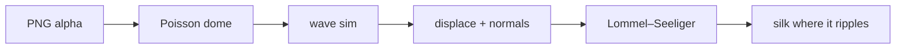

<!-- For people reading about silkify, not one of the skill's steps: SKILL.md does not need it. Moved here from the README; 简体中文: how-it-works.zh-CN.md. -->

English | [简体中文](how-it-works.zh-CN.md)

# How silkify works

<!-- byline -->Made by <a href="https://github.com/RussGuo">Russ Guo</a><!-- /byline -->

## From a picture to silk

1. **Silhouette → dome.** The alpha channel gives the outline (an opaque picture becomes a rounded rectangle). silkify solves Poisson's equation ∇²u = −1 inside the outline with u = 0 on it, and sets the height to 2√u. For a disc this is exactly a hemisphere. Thin parts bulge less, and there is no crease along the middle like the one a distance field folds in. The moon skips this step and uses a real sphere.
2. **Waves.** A damped wave equation runs on two half-float render targets in ping-pong: r holds height and g holds velocity. The pointer presses a dent into it. For images, the field is zeroed outside the silhouette, so waves reflect off the outline and the outline never moves.
3. **Displacement and normals.** The height field moves the surface: along the normal for the sphere, and along the view axis for images, so the outline cannot fold. The ripple slope is added to the normal. For images it is scaled by n.z, which is the exact sum for a height field and fades to zero at the outline.
4. **Matte photometry.** The surface is lit by Lommel–Seeliger, the back-scattering model of lunar soil. The lit face stays almost flat, so the picture looks like itself, and the terminator is crisp. A floor keeps the far side from going black. A fill-light gradient follows the pointer on a critically damped spring and drifts slowly when idle.
5. **Silk only where touched.** A satin overlay and a soft highlight both scale with the local ripple energy. At rest that energy is zero, so the object is a photograph. Where it ripples, the object turns to silk, and nothing switches abruptly between the two materials.

## What it costs

By default, silkify renders inside a **Web Worker** on an OffscreenCanvas, so three.js, picture decoding, the Poisson solve, shader compilation and every frame stay off the main thread. Where workers cannot render, it falls back to the main thread; without WebGL2 it falls back to a still frame.

| Tier | When | What it does |
|---|---|---|
| `high` | desktop-class devices | pixel ratio ≤ 2, simulation ≤ 256 cells, mesh ≤ 240; one idle light loop, then sleep |
| `low` | touch-first, a screen < 1024 px on its long side, ≤ 4 cores, ≤ 4 GB, or a software GPU | pixel ratio 1, simulation ≤ 128, mesh ≤ 120; frames only around interaction |
| `static` | reduced motion, Save-Data, 2G, very small devices, no WebGL2 | three.js is never loaded; `poster` (or the picture) is drawn once |

The tier is decided once, at mount; `tier` forces one.
- **Resolution** (simulation, mesh, texture) follows the object's size on screen, with sub-stepping that keeps dents and waves the same size and speed.
- **No MSAA, no depth or stencil buffer.** They add nothing to this picture and cost about 18 MB per canvas at ratio 2.
- **The loop sleeps:**
  - 60 fps while touched and for 8 s after;
  - 12 fps for the ripple tail until 20 s;
  - then nothing.
  - A lifted finger stops counting as hovering, and a pointer anywhere else on the page never wakes the object.
  - The wave solver runs at a fixed 60 steps a second, so ripples move at the same speed on a 30, 60 or 120 Hz display.
  - `breeze` and `autoplay` are off by default because they keep it awake: breeze draws 30 fps while visible, and autoplay wakes for every drop.
  - Off-screen and hidden tabs stop the loop.
  - The pixel ratio steps down 2 → 1.5 → 1 if the GPU falls behind.

The gallery shows the pattern for many objects on a page:
- Each card starts as a lazy-loaded WebP **poster** (a real rendered rest frame, 1x/2x).
- The live renderer mounts on the first touch and is released when the card scrolls away.
- At most 3 are live at once.

The Lighthouse measurements of the gallery, v0.2.0 against v0.2.1, and every other number behind this page are in [performance.md](performance.md) ("Measured on the gallery").
