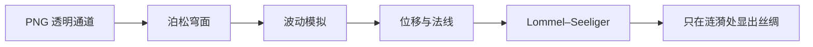

<!-- 写给想了解 silkify 的人看，不是 Skill 的步骤，SKILL.md 用不到它。内容从 README.zh-CN 挪来；English: how-it-works.md。 -->

[English](how-it-works.md) | 简体中文

# silkify 的原理

<!-- byline -->作者：<a href="https://github.com/RussGuo">Russ Guo</a><!-- /byline -->

## 从一张图到一块丝绸

1. **轮廓 → 穹面。** 透明通道给出轮廓；不透明的图片当作圆角矩形。在轮廓内解泊松方程 ∇²u = −1（轮廓上 u = 0），高度取 2√u。对圆盘，这恰好是半球。细的部分鼓得低，中轴上也不会像距离场那样折出一道棱。月球跳过这一步，直接用真球。
2. **波动。** 阻尼波动方程在两张半浮点渲染目标上 ping-pong 交替运行：r 通道存高度，g 通道存速度。指针在上面压出凹坑。图片模式下轮廓外恒为零，所以波在轮廓处反射，轮廓本身永远不动。
3. **位移与法线。** 高度场推动表面：球体沿法线，图片沿视线方向，所以轮廓不会折叠。涟漪斜率叠加到法线上；图片模式下再乘以 n.z，这对高度场是精确叠加，并在轮廓处自然归零。
4. **哑光的光照模型。** 用 Lommel–Seeliger 光照，也就是月壤的背散射模型。受光面几乎是平的，所以图片看上去还是它本来的样子；明暗交界利落，背光面留有最低亮度，不会黑成一个洞。补光跟着指针走，用临界阻尼的弹簧去追，所以不会抖；没人碰时它慢慢扫一圈。
5. **只在被触碰处显出丝绸。** 缎面叠加与柔和高光都随局部涟漪能量缩放。静止时能量为零，物体就是一张照片；起涟漪的地方变成丝绸，两种材质之间是连续过渡，没有生硬的切换。

## 性能

silkify 默认在 **Web Worker** 里的 OffscreenCanvas 上渲染。three.js 的执行、图片解码、泊松求解、着色器编译和每一帧的绘制都不占主线程。Worker 渲染不了就退到主线程；没有 WebGL2 就只画一张静态图。

| 档 | 何时 | 做什么 |
|---|---|---|
| `high` 高 | 桌面级设备 | 像素比最高 2，模拟最多 256 格，网格最多 240 段；闲置时补光扫一圈，然后停止渲染 |
| `low` 低 | 以触屏为主、屏幕长边小于 1024、CPU 不超过 4 核、内存不超过 4 GB，或者是软件光栅 | 像素比 1，模拟最多 128 格，网格最多 120 段；只在有人交互的前后才渲染 |
| `static` 静态 | 系统要求减少动态效果、省流量模式、2G 网络、设备太弱，或没有 WebGL2 | 不加载 three.js，只把 `poster`（或原图）画一次 |

档位在挂载时只判断一次；`tier` 参数可以强制指定。
- **分辨率跟着物体在屏幕上的大小走。** 模拟网格、几何网格和贴图都按它实际占多少像素来定；模拟格子变粗时，求解器会折算常数、每帧多走几步，所以凹坑和波纹相对物体的大小与快慢不变。
- **不开 MSAA，也不要深度与模板缓冲。** 这个画面用不上它们，而像素比 2 时每块画布要为此多占约 18 MB。
- **不需要画的时候就不画：**
  - 被触碰时和碰后 8 秒内按 60 fps 渲染；
  - 之后降到 12 fps 把余波算完，到第 20 秒清零；
  - 再往后一帧都不画；
  - 手指抬起就不再算悬停；指针在页面别处移动或按住，不会唤醒物体；
  - 波动求解固定每秒 60 步，30、60、120 Hz 的屏幕上涟漪一样快；
  - `breeze`（微风）与 `autoplay`（自动落滴）默认关闭，因为开了就得一直画：微风在可见时保持 30 fps，每落一滴都会把物体唤醒；
  - 离开视口或标签页切到后台就停；
  - GPU 跟不上时，像素比自动从 2 降到 1.5，再降到 1。

画廊演示了「一页多个物体」的做法：
- 每张卡片先显示一张懒加载的 WebP **静态图**，就是渲染器画出来的静止画面，分 1x 与 2x 两档。
- 第一次被碰到时才挂载实时渲染，滚出视口就释放。
- 同时最多 3 个实时渲染。

### 画廊实测

全程不碰任何卡片，所以每张卡都还是静态图。Lighthouse 12.8.2，移动预设（模拟 CPU 4 倍降速），3 次取中位数，Chrome 156，Apple M1 Pro。「真 GPU」指有界面的 Chrome 走 Metal；SwiftShader 是无头 Chrome 与 CI 用的软件 GPU。

| | v0.2.0 | v0.2.1 |
|---|---|---|
| 性能分，真 GPU / SwiftShader | 100 / 69 | **100 / 99** |
| TBT（总阻塞时间），真 GPU / SwiftShader | 14 ms / 9,744 ms | **0 ms / 0 ms** |
| 主线程总耗时，真 GPU / SwiftShader | 0.25 s / 10.2 s | **0.18 s / 0.16 s** |
| 传输字节 | 0.48 MB | 0.49 MB |
| CLS（累计布局偏移） | 0 | 0 |
| 挂载一张卡时主线程的长任务（真 GPU） | Worker 里没有；主线程渲染时 57 ms | 同左 |
| 静止 10 秒画的帧数 | 0 | 0，指针在页面别处移动时也是 0 |

v0.2.0 加载时会在主线程临时建一个 WebGL 上下文来探测 WebGL2，软件 GPU 上这一步要花好几秒；v0.2.1 改成在 Worker 里用画布自己的上下文探测。最后两行是脚本在有界面的 Chrome 里量的，因为 Lighthouse 不会去碰页面。细节见 [performance.md](performance.md)（英文）。
